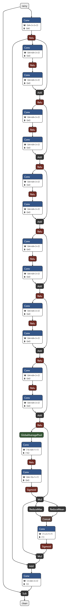

# 1. 请你将调研的每一篇文章体现在 markdown 文件中，需要看到对文章方法的理解和对你的启发

## 论文调研（一）：PReNet

**论文**：Progressive Image Deraining Networks: A Better and Simpler Baseline
**作者/出处**：Dongwei Ren 等，CVPR 2019｜arXiv:1901.09221｜官方代码：github.com/csdwren/PReNet

### 一、这篇文章想解决的问题

单图像去雨是个病态问题，雨层和背景层混在一起，构成复杂。传统优化方法靠手工正则刻画不清两层，性能有限；深度学习兴起后，方法越做越复杂，带来两个毛病：一是**说不清到底哪个部件在起作用**，想在已有网络上继续改都无从下手；二是**损失一混合，调参负担重**。另一类轻量方案又以明显掉点为代价。

于是作者提出**两个主张**：

1. 只组合少数几个模块，就能做出比当时更深更复杂的 SOTA 更好的模型；
2. 与早期 DerainNet"直接预测干净图很难训"的结论相反——**网络本身变好之后，直接从雨图恢复干净图并不难训**。

### 二、方法理解

#### 整体结构：一个浅网络，递归跑 6 遍

PReNet 的本体只是一个浅层 ResNet，由三段组成：

- **f_in**：1 层卷积 + ReLU，做浅层特征提取
- **f_res**：5 个 ResBlock，做深层特征提取
- **f_out**：1 层卷积，把特征变回一张图

把这个小网络**在 6 个 stage 之间共享同一套参数、递归展开**，就是 PRN（Progressive ResNet）；再在 stage 之间加一个 ConvLSTM 传递状态，就是 PReNet。全网所有卷积都是 3×3、全程 32 通道、**不做任何下采样**，分辨率从头到尾不变。

#### 每个 stage 怎么工作

第 t 个 stage 做四件事（数据流）：

1. **拼接输入**：把上一 stage 的估计图 $x^{t-1}$ 和**原始雨图 y** 沿通道拼起来，喂给 f_in 时变成 32 通道特征。第一个 stage 没有上一 stage 的图，代码里就把 y 自己和自己拼。
2. **ConvLSTM 更新状态**：浅层特征先和上一个 stage 传下来的隐藏状态 h、细胞状态 c（都是 32 通道、和原图同分辨率，从 0 开始）做一次 LSTM 更新，得到这一 stage 的状态。注意到它传的是**特征级状态**，和第 1 步的图像级拼接是两条不同的"记忆通道"。
3. **5 个 ResBlock 处理**：每个 ResBlock 是 Conv→ReLU→Conv，输出再与**本块的输入**原样相加、最后过一次 ReLU。
4. **输出负残差**：f_out输出的结果与原图**相加**得到本 stage 的去雨图。也就是说网络实际学的是负的雨层，加上原图即得干净图。

整网就是把这套流程用**同一组参数连跑 6 遍**。每一轮之间同时传两样东西：成果图 x（图像级通道）和状态 h、c（特征级通道）。

直观效果：第 1 个 stage 就去掉大部分雨纹，后面 stage 逐步清除残余——这就是标题里 Progressive 的含义，**指的是结构上逐 stage 渐进去雨**。

#### 损失极简

- 默认损失只有一个：**负 SSIM**，而且**只监督最后一个 stage 的输出**。
- 论文还试了只监督最终输出的单 MSE（够用，但不如负 SSIM），以及给每个 stage 都加监督的"递归监督"——后者对最终指标**没有增益**，只是让中间 stage 的图更好看。作者借此把损失也做了减法：混合损失、GAN 损失一概不用。

#### 消融证据

消融分别证明了（在 Rain100H 上）：

| 部件 | 证据 | 结论 |
| --- | --- | --- |
| stage 数 T | T 从 2 到 6 单调变好（27.27→29.32），T=7 略降 | T=6 是甜点，渐进迭代确实有用 |
| 每 stage 拼原图 y | 不拼 28.91 → 拼 29.46 | 几乎零成本的明确收益 |
| 跨 stage ConvLSTM | 无（PRN）28.07 → 有 29.46 | **单个部件里增益最大（约 +1.4 dB)** |
| 残差学习 vs 直接预测 | 直接预测 29.32 → 残差 29.46 | 残差略优，但直接预测也可行 |
| LSTM vs GRU | 29.32 vs 29.08 | LSTM 略优 |
| stage 内递归（_r 变体） | 只用 1 个 ResBlock 循环 5 次：参数降到 94,979，只掉约 0.5 dB | 参数预算紧时的好办法 |

### 三、对我的启发

1. **"一个小网络递归多跑几遍"是小参数预算下的最优解之一**。参数不随深度涨（权重共享），却天然得到"先去大雨、再修残余"的迭代细化。我们自己的模型上限 4M 参数，这个思路可以把参数花在刀刃上。
2. **每 stage 重新拼回原始雨图**，等于每轮都让模型对照原图自查"哪里还有雨、哪里误删了背景"，成本只是输入卷积多 3 个通道。
3. **跨 stage 的记忆要用特征级状态，而不是只传图像**。上一轮的输出图信息量有限，ConvLSTM 的 32 通道状态能携带更丰富的中间判断，它是全篇增益最大的部件。
4. **输出用负残差相加**：网络只学"要改的那部分"，每个 stage 的输出都是合法图像，训练稳定、还能随时把中间结果画出来看去雨进程，对调试极其友好。
5. **先把单损失跑通再谈花样**。单一负 SSIM（甚至单 MSE）+ 只监督最终输出就能打赢一堆混合损失模型；多 stage 监督听起来美好但实测无增益。

## 论文调研（二）：SPANet

**论文名片**：Spatial Attentive Single-Image Deraining with a High Quality Real Rain Dataset，CVPR 2019。作者 Tianyu Wang、Xin Yang（共同一作）、Ke Xu、Shaozhe Chen、Qiang Zhang、Rynson W.H. Lau（通信作者），大连理工大学、香港城市大学。arXiv:1904.01538（v1 2019-04-02，v2 2019-08-18；本文以 v2 为准）。官方代码：chiukin/SPANet。

### 核心思想

**"先检测、后去除"**：先算出一张"哪里有雨"的注意力图，并且**用真值直接监督这张图**，再用它给后面的残差块"划重点"——有雨的地方使劲去，没雨的地方少动手。论文的另一半工作是自建了一套约 2.95 万对的真实雨图数据集，解决了"真实雨没法定量评测"的问题。

### 针对两个痛点

1. **合成雨不像真实雨**：已有方法只在合成数据上训，合成雨模拟不了真实雨纹的形状、方向、强度变化。按轻、中、重三档给雨分密度本身就难分，错分还会拖累去雨。
2. **真实雨没有可定量的基准**：真实雨图和干净图没法同时拍到，所以以前只能定性看图对比，没法算分。

**支撑后面方法与数据集的两个观察**：1. 雨滴高速下落，**不太可能一直盖住同一个像素** 2. 被雨盖住的像素亮度会在**真实背景亮度之上波动**（雨纹倾向于提亮背景）。

### 整体结构

全卷积网络，输入一张雨图、输出一张去雨图，**不做任何下采样**，全程 32 通道。

```text
雨图 → conv_in（3→32）→ 3 个普通残差块
     → [SAM 算注意力图 → 3 个注意力门控残差块] × 4 组
     → 2 个普通残差块 → conv_out（32→3）→ 去雨图
```

- 残差块是 Bottleneck 式：1×1 卷积 → ReLU → 3×3 空洞卷积（空洞率 dilation=2）→ ReLU → 1×1 卷积；块外的残差相加在主干里做。
- 4 组里的 SAM 是**同一个模块复用**，即论文说的"权重共享"。但每组的注意力图都由当时的特征重新算，不是把第一张图沿用到底。

### SAM：空间注意力模块（全文最值得抠的部分）

#### IRNN

IRNN 是用 ReLU 激活＋单位矩阵初始化的循环神经网络。论文引用它的理由：易训练、擅长建模长程依赖、计算高效。关键：**这里的"循环"是沿一张图内的空间方向递推，不是沿时间的循环**。

#### 两轮四方向

对特征图上每个位置，沿上、下、左、右四个方向做递推累积（四个逐通道 1×1 卷积分别管四个方向，每步把邻位的值累积过来再 ReLU）：

- **第一轮（局部）**：每个位置只汇总水平／垂直邻域的信息，用于建模雨纹的局部物理特性。
- **第二轮（全局）**：同样的四方向操作再来一遍，上下文从整张特征图汇聚过来，得到全局感知的特征图。

#### 方向注意力

SAM 里除了 IRNN 分支，还有一条"自注意力分支"。它由两层 3×3 卷积＋一层 1×1 卷积＋sigmoid 算出 **4 通道权重图**，四个通道分别对应上、下、左、右四个方向。在每轮 IRNN 之后，四个方向图**各乘自己对应的那一通道权重**，再拼起来经 1×1 卷积融合。也就是说，网络在自己学"这个位置更该信哪个方向传来的信息"。

#### 显式监督（复用成本低）

损失里有一项 **$L_{Att}$ = ‖A − M‖²**，其中 A 是**第一个 SAM**的注意力图（只监督第一张，不是四张全监督），M 是二值雨图——由**雨图与干净图的差值阈值化**得到，1 表示该像素被雨覆盖、0 表示没被覆盖。

这样一来，只要训练数据自带干净图，这张监督图就是**免费算出来的，不需要额外标注**。注意力头不再是"自己悟"，而是"开卷考试"。

### 消融（表 4，自建真实测试集）（由原文摘录）

| 变体 | 含义 | PSNR | SSIM |
| --- | --- | --- | --- |
| Ba | 纯 ResNet 基线（无 SAM） | 37.43 | 0.9856 |
| Bb | 单个 SAM 用 4 次 | 37.43 | 0.9854 |
| Bc | 4 个 SAM，不共享权重 | 37.47 | 0.9854 |
| Bd | 4 个 SAM 共享权重，但去掉 self-attention branch | 37.70 | 0.9858 |
| Be | 共享权重＋branch，但去掉 attention loss | 37.39 | 0.9856 |
| **Bf** | **完整 SPANet** | **38.06** | **0.9867** |

**总结：** SAM、注意力、共享权重的收益是**组合生效**的，单拎一项未必有用。

### 对我的启发

1. **注意力图显式监督**：只要训练数据有干净图，就能用 |雨图 − 干净图| 阈值化免费造出二值雨图 M来当注意力头的监督真值。实现上只是一个单通道 sigmoid 头＋一项 ‖A−M‖² 损失，参数代价几乎为零。而消融显示 attention loss 单项值 **＋0.67 dB**，是 SPANet 消融里最大的单项增益。给 MyModel 加一个这样的辅助头**性价比极高**。
2. **注意力模块权重共享**：一个 SAM 的权重在多个阶段复用，消融显示比不共享 **＋0.59 dB**，参数不增反"赚"，对 ≤4M 参数上限非常友好。
3. **门控残差块可简化接入**：残差分支输出 × 注意力图 ＋ 输入的写法，和现有 BaselineNet／DerainNet 的残差思路同构，迁移零成本。可以先以简化版空间注意力（不上 IRNN）接入现有代码验证收益。
4. **空洞卷积扩感受野**：代码里 Bottleneck 中间 3×3 卷积的空洞率是 2，可以不降分辨率、不增参数地扩大视野，适合雨纹这种长条结构。具体空洞率组合可以自己试验 1／2／4 这样的组合。

## 论文调研（三）：MPRNet

**论文名片**：MPRNet: Multi-Path Residual Network for Lightweight Image Super Resolution，WACV 2021，pp. 2704-2713。作者 Armin Mehri、Parichehr B. Ardakani、Angel D. Sappa，巴塞罗那计算机视觉中心（CVC／UAB）、ESPOL 理工大学。arXiv:2011.04566。DOI：10.1109/WACV48630.2021.00275。

### 核心思想

**用便宜的办法把多路信息都留住，再用注意力把有用的放大**：主干不靠堆很深很宽的卷积，而是让每个残差块走多条学习路径（空间、平滑、直通），再把不同深度的块拼起来用 1×1 卷积融合，最后用一个同时看通道和位置的注意力模块把关键信息提出来。目标是在参数量很小的前提下，追平甚至超过参数量大几倍的重型超分辨率网络。

### 针对轻量超分辨率的痛点

1. **重型网络精度高但用不起**：一些网络靠加深加宽、去掉 BN、堆残差和密集连接提 PSNR，代价是参数和计算量暴涨，容易过拟合，也放不进许多真实应用场景。
2. **早期轻量网络精度不够**
3. **MobileNet 式瓶颈在超分辨率里会丢信息**：倒置残差把特征先压窄再放宽，窄的那段容易造成梯度混淆、丢高频信息，而超分辨率恰恰最需要高频细节。

### ARB：自适应残差块（全文最值得抠的部分）

ARB 不像普通残差块只有一条“卷积→激活→卷积→相加”的路，它是**三条路并行、最后汇合**：

- BN 路用 **Dw＋Pw** 代替普通卷积：Dw 只在每个通道内做空间卷积，Pw 只做 1×1 通道混合，两步拆开比一步普通卷积便宜得多，又能学到空间＋通道两类信息；
- Adp 路用平均池化。因为低分辨率图常带噪，平均一下能平滑噪声，相当于给网络一个“先看大势”的稳定信号；
- Res 路放在高维：窄瓶颈会丢信息、混淆梯度，高维直通是这篇对 MobileNet 瓶颈的直接修正。

### TFAM：双重注意力模块

TFAM 同时回答两个问题：**通道上“什么重要”（what），空间上“哪里重要”（where）**，由两个单元拼成。

- TFAM 在通道单元用**一阶统计（平均池化）**、在位置单元用**平均＋最大池化沿通道轴**拼描述子，论文认为这样更能突出边缘这类重要特征；
- TFAM 还被塞进两个地方：ARB 的瓶颈路里（第二个 Dw 之后），以及特征模块 FM 里（RM 之后、GFE 之前），是“块内＋模块间”两级精炼。

### 三种残差连接

论文在消融表 6 里拆了三种连接：

| 连接 | 全称 | 位置和作用 |
| --- | --- | --- |
| LRC | 局部残差连接（Local Residual Connection） | RCB 内部，块内 ARB 之间的残差；论文指出，单用 LRC 时 1×1 卷积的乘性操作会干扰优化，效果甚至略低于无连接基线 |
| GRC | 全局残差连接（Global Residual Connection） | RM 整体，把各 RCB 的输出拼起来、经 1×1 卷积融合后传下去；单用 GRC 比基线好，因为它把中层到高层的信息都收集起来了 |
| LRSC | 长程跳连（Long-Range Skip Connection） | 从浅层（SFE 附近）直通到 FM 末尾，保证高层在进 UP-Net 之前还能拿到“没被改过的”原始信息，也可以缓解梯度消失／爆炸 |

三者全开时最好（表 6），说明这篇的“多路”不只是 ARB 内部三路，还包括**块内、模块间、浅层到深层**三层残差连接。

### 消融（全部是超分辨率集上的数）（只选取比较有感触的）

#### 表 5：残差块本身和 ARB 三条路（×4）

| 配置 | B100 | Urban100 |
| --- | --- | --- |
| MobileNet 瓶颈块 | 27.24 | 25.79 |
| EDSR 残差块 | 27.44 | 25.96 |
| RCAN 残差通道块 | 27.52 | 26.08 |
| ARB 只有瓶颈路 | 27.46 | 26.05 |
| ARB 瓶颈＋自适应路 | 27.58 | 26.15 |
| ARB 瓶颈＋残差路 | 27.55 | 26.11 |
| **ARB 三路全开** | **27.63** | **26.31** |

三路全开比单瓶颈路高约 ＋0.17／＋0.26 dB，比 RCAN 块高约 ＋0.11／＋0.23 dB。

说明三条路是**叠加生效**的，单拎一条路（尤其只留瓶颈路）还不如 RCAN 块。

#### 表 6：三种残差连接（×3）

| 配置 | Set5 | Urban100 |
| --- | --- | --- |
| 无连接（基线） | 34.42 | 28.30 |
| 只有 LRC | 34.40 | 28.29 |
| 只有 GRC | 34.47 | 28.35 |
| 只有 LRSC | 34.45 | 28.33 |
| LRC＋GRC | 34.52 | 28.38 |
| **三者全开** | **34.57** | **28.42** |

全开比基线高 ＋0.15／＋0.12 dB。单用 LRC 反而微降，这个地方很有启发：**不是连接越多越好、也不是每种连接单拎都正向，是组合起来才把 1×1 融合的优化问题抵消掉**。

### 对我的启发

1. **ARB 的三路思想可以直接搬到 MyModel 的残差块里**：瓶颈路用 Dw 3×3＋Pw 1×1 代替普通 3×3 卷积，参数和计算量立刻下来，对 ≤4M 上限非常友好。再加一条全局平均池化＋1×1 的自适应路平滑噪声、一条高维直通路保梯度。这三路在超分辨率上是叠加生效的，去雨里雨纹也是空间结构＋噪声的混合，值得借鉴。
2. **TFAM 的“通道＋位置”双单元**：去雨恰恰需要“哪里有雨”（位置）和“哪个通道的雨纹更重”（通道）两个判断，TFAM 的结构比只用通道注意力更合适，值得借鉴。
3. **多级拼接＋1×1 融合**：把不同深度块的输出拼起来再用 1×1 卷积压回原通道数，比“只用最后一层特征”更稳，和 UNet 的跳连是同一类思想，值得借鉴。
4. **三层残差连接的组合意识**：块内残差、模块间残差、浅层到深层的长程跳连要**成组上**，单用局部残差在表 6 里甚至微降。

# 2. 调研单图像去雨的文章？那么应该怎么找到需要的文章呢？🤔请总结你寻找文章的方法

## 一、先定 scope，再动手搜

没定 scope 就搜，效率极低。动手前先回答四个问题：

1. **任务边界**：只要单图像去雨。复原类文章常把几个任务放一起，标题里常有 restoration、deraining、deblurrin，要先看摘要确认主任务。
2. **要解决的具体问题**：是找整体架构、找注意力模块、找损失函数、找数据集，还是找对比基线？
3. **能不能复现**：任务要搭自己的模型，优先找有代码、结构不依赖特殊算子、参数量可算的文章。只有图和公式、没有代码细节的文章先放后备区。

**先想清楚要什么，再去搜；搜到的第一任务是排除，不是收藏。**

## 二、关键词：中英文搭配，分三层拼

只搜“去雨”两个字会漏掉大半，英文关键词要分层组合，技巧：

- 任务词 + 方法词，搜到的才是“能借鉴的文章”，不是“所有去雨文章”；
- 任务词 + 数据集名拼，搜到的就是“能在同一张表里比的文章”；
- 同一个意思换词再搜一遍：deraining、rain removal、rain streak removal 三个词的结果集并不完全重合；
- 加年份过滤时要小心：经典文章（如 PReNet 2019）不会因为年份老就没价值，筛选时按“引用量 + 是否被后续文章当作基线”判断，不能按年份一刀切。

## 三、六个渠道

### 1. 先读综述，再读单篇

最省时间的一步。先搜 `single image deraining survey` 或 `image deraining review`，找一篇近年的综述，把去雨文章按“传统方法 / CNN / 注意力 / 多阶段 / Transformer / 真实雨图”分好类，记下每类的代表作和时间线。有了这张地图，后面单篇就不会迷路，也不会把不同年代、不同数据集的文章放在一起比。

### 2. arXiv：找原文和版本号

arXiv 是去雨文章最常用的首发地。

注意：1. **看版本** 2. **arXiv 只是预印本**，最终发表信息（会议、期刊、页码）要以发表版本为准。

### 3. Google Scholar / Semantic Scholar

这两个库的核心价值是“追”：

- **向后追（参考文献）**：打开一篇已经确认的好文章，看它的参考文献，里面一定有值得挖掘的文章。
- **向前追（被引用）**：在 Google Scholar 点“Cited by”，或在 Semantic Scholar 看引用它的文章，可以找到关于这篇文章的后续发展、优化。

### 4. Papers With Code

在 Papers With Code 上按任务或数据集反查，能一次性看到“在同一个数据集上，哪些文章报了哪些分数、有没有代码”。用法：

- 先按数据集筛，再按分数排序，找出当前在该数据集上的代表性文章；
- 点进文章看它有没有官方代码链接、代码是不是原作者维护的；

### 5. 顶会顶刊

浏览方法：

- 去会议官网按年份看 Oral / Poster 列表；
- 再用“标题 + 摘要”十分钟筛一遍，只留 3～5 篇精读；
- 期刊文章通常更完整，适合找数据集和评测细节。

### 6. GitHub

GitHub上能找到代码，这可以让我们：

- 确认模型结构是不是真如论文图上画的那样；
- 判断复现成本
- 看 Issues 和 README：别人踩过的坑、作者给的训练细节，经常比正文实用。

## 四、筛选方法

每篇候选文章，先花十分钟过这六项，过不了就放进“不读”或“后备”：

1. **标题 + 摘要**：任务是不是单图像去雨？核心思想一句话能不能说清？
2. **结构图**：输入输出尺寸变不变？有没有我们关心的结构？
3. **表格**：在哪个数据集上测的？PSNR / SSIM 是在 Y 通道还是 RGB 上算的？是单模型还是每个数据集单独训的模型？
4. **消融**：有没有把每个模块单独拆开测？
5. **代码和参数量**：有没有官方代码？参数量、计算量给没给？
6. **引用关系**：它是否引用了我们已经读过的文章？是改进它、还是只是把它当基线？

# 3. 调研文章时，想必会遇到英文看不懂、文章看不进去、理解不了作者的方法等问题。在面对这些问题时，你会怎么解决呢？🤔请总结你处理一篇文章的方法

## 一、先换一个目标：不是读懂每个词，是拿到四样东西

1. **它解决什么问题**：输入是什么、输出是什么、难在哪里；
2. **核心 idea 一句话**：它和前人比，新在哪一步；
3. **结构怎么走**：数据从输入到输出经过了哪些模块、每步尺寸变不变；
4. **证据是什么**：在哪个数据集上、什么口径下、比基线高了多少、消融证明了哪个模块有用。

## 二、3遍读法

### 第1遍：10～15 分钟，只看“地图”

- 标题、摘要、结论；
- 结构图（Architecture Figure）和它的图注（Caption）；
- 表格的表头和第一列：数据集、对比方法、指标；
- 小节标题。

读完要能回答：这篇是干嘛的？输入输出是什么？核心模块叫什么？如果答不上来，说明这篇可能不在我们的 scope 里，先放后备，不要硬读。

### 第2遍：30～60 分钟，只跟“数据流”

- 每遇到一个模块，先问：输入尺寸是多少、输出尺寸是多少、变没变？
- 每遇到一个公式，先问：它是定义输出的式子，还是一个损失？
- 每遇到一个表格，先问：这张表想证明什么？

### 第3遍：只读和自己任务有关的部分

- 要借鉴某个模块，就只精读讲那个模块的一节，外加它的消融表；
- 要引用某个数字，就只精读那张表和它的评测口径说明；
- 要复现代码，就对照官方代码读对应的一节。

## 三、单词和长句

### 1. 专业术语：建一张术语表

建表的方法：每篇论文只记 10～20 个真正影响理解的词，记“在这篇里是什么意思”，而不是抄词典的全部释义。

### 2. 缩写

缩写第一次出现时一般会给全称。读的时候养成习惯，**第一次见缩写就把全称抄到术语表里**。

### 3. 长句：先找主干，再看修饰

英文论文的长句通常是“主句 + 一串从句 / 插入语”，先把主干抽出来，再看修饰部分补了什么条件。

- 遇到从句，先跳过去读主干，读完主干再回头看从句；
- 遇到被动语态把它翻成主动。

## 四、公式

每个公式先问四个问题：

1. **左边是什么**：是输出、损失，还是中间变量？
2. **右边每一项是什么**：输入、权重、上一阶段的结果，还是干净图？
3. **尺寸变没变**：输入输出的通道数、高宽变没变？
4. **这一步在流程图里是哪一块**：公式能不能指到结构图上的某一个框？

## 五、图和表

英文论文里，图和表往往比正文更直观，应优先阅读。

1. **结构图**：先看箭头走向，再看每个框的名字，最后看图注里对每个框的解释。结构图看懂了，正文的 Method 一节就只剩细节。
2. **效果图**：对比图里，重点看“别人错在哪、这篇对在哪”。
3. **表格**：先看表头，再看行，最后看列。消融表要横着看：基线是多少、加一个模块涨多少、加两个模块涨多少？

## 六、代码

如果某一段正文反复读不懂，优先去找官方代码。代码的好处：

- 变量名、函数名、注释更直白；
- 尺寸、通道数、调用顺序明确；
- 可以直接跑一个小输入，看每一步的输出尺寸，验证自己的理解对不对。

## 读不下去的时候，先问自己：我是卡在单词、长句、公式、还是结构上？按上面对应的那一节换方法，不要笼统地觉得“这篇太难了”

# 4. “渐进式训练”是什么、为何成为范式、与出题人给定方法的异同、它的优劣在哪、科研是否应遵循范式

## 一、渐进式训练是什么

### 1. 大致理解

是一种**训练日程**：训练开始时用比较容易、比较小的设置让模型先学会基本映射，随着训练推进，逐步把任务变难、把输入变大，直到覆盖测试时真正要面对的难度和尺寸。

### 2. 直观的比喻

固定尺寸训练像是“一直用同一套 100 道小题练，考试却突然考大题”。渐进式训练像是“先用小题把基本功练熟、练快，再逐步换成大题练全局视野和细节保留”。小题的好处是练得快、一步的代价小，大题的好处是和考试更像。渐进式训练就是把这**两段拼起来**，而不是只选一段。

## 二、它为什么会成为范式

### 1. 解决了训练和测试尺寸的不匹配

复原任务的测试图通常是全分辨率、尺寸各不相同，而训练为了省显存、省时间只能裁成小块。如果整个训练只用一种小块，模型学到的统计量就偏向小块，测试时面对大图会水土不服。混合尺寸训练让模型在训练时就见过多种尺寸，测试时换尺寸也不慌。

### 2. 兼顾了速度和精度

只用大块训：精度可能高，但每一步慢、占显存大、收敛慢。
只用小块训：每一步快、迭代多，但精度受限于小块的视野和统计量。
渐进式把两者拼起来：早期小块 + 大 batch，快速学会基本映射、快速迭代；后期大块 + 小 batch，补全局视野和细节。

### 3. 科研对比的公平性

当越来越多 SOTA 文章都用同一套渐进日程报分数时，后来的文章如果还用固定小块训，审稿人和读者会先怀疑“分数低是因为训练日程没跟上”。为了公平比较，大家被迫沿用同一套日程，也就是说**它一开始是因为有效而被用，后来是因为大家都用而不得不被用**。

## 三、与出题人给定训练方法的区别与它的优劣

### 对比表

| 维度 | 出题人给定方法（固定式） | 渐进式训练 |
| --- | --- | --- |
| 训练块尺寸 | 全程固定一种尺寸 | 从小到大分阶段增大 |
| Batch size | 全程固定 | 随块增大而减小 |
| 学习率 | 全程固定 1e-4，无调度 | 全程余弦退火 |
| 训练阶段 | 不分阶段，一次训到底 | 按迭代次数分阶段，每阶段换块尺寸和 batch |
| 样本难度 | 不按难度排序，全程随机 shuffle | 隐含由易到难：小块 / 简单结构先学，大块 / 精细结构后学 |
| 总迭代量 | 由 epochs × 数据集大小 / batch 决定，任务中通常是几十上百轮 | Restormer 原版是 300K 次迭代，量级远大于课程训练 |
| 实现复杂度 | 极低：一个 DataLoader、一个循环就能跑 | 较高：要按迭代次数切换 DataLoader 的块尺寸和 batch，还要协调学习率曲线 |
| 目标 | 让不同模型在同一套简单设置下可比，突出模型结构本身的差异 | 在追求 SOTA 时，让模型更好地适应全分辨率、多尺寸测试图 |

### 它的优点和缺点

**优点：**

1. **更好地适应多尺寸测试图**
2. **速度和精度的折中更好**：早期小块快、后期大块准，总时间不比全程小块训多太多。
3. **符合由易到难的学习过程**：先学会基本映射再学细节，收敛过程更稳。

**缺点：**

1. **超参数变多了**：块尺寸序列、batch 序列、学习率曲线都要调，调不好反而比固定式更差，阶段交界处还可能出现损失突升。
2. **后期小 batch 带来梯度噪声**：小 batch 本身会让梯度估计产生更多噪声，需要配合学习率调度才能稳住。
3. **收益依赖模型和任务**：对小感受野的 CNN、小数据集、测试尺寸固定的任务，渐进式的收益可能不大。
4. **实现成本和总计算量高**：Restormer 原版 300K 次迭代、后期大块的计算量，对任务的单卡、短训练来说难以实现。

## 四、科研是否应遵循范式

我认为：**不应该盲目遵循，应该有条件地遵循，并且要把范式当作“对照组”，而不是“标准答案”。**

### 1. 什么时候应该遵循

- **目标是刷 SOTA、和最新工作公平比较时**：如果同行都用渐进式日程报分数，我们不用同一套日程，分数就没有可比性。
- **模型本身需要大视野 / 全局统计量时**
- **有足够算力和时间做完整日程时**

### 2. 什么时候不应该盲目遵循

- **模型小、数据小、测试尺寸固定时**：渐进式的核心收益（适应多尺寸、学全局统计量）在这种设置下本来就小，强行上渐进式不仅作用小，成本还高。
- **范式本身没有在我们的情况验证过时**

### 3. 正确的科研态度：把范式当对照组，而不是当真理

范式在科研里的正确位置应该是这样的：

1. **先理解它为什么有效**：是解决了尺寸 mismatch、还是只是余弦退火和长训练的功劳？把原因拆开，才能判断它对我们的问题还成不成立。
2. **做对照实验，而不是口头站队**：在自己的模型和数据上，用相同的总计算量（或相同的总迭代次数）跑两组，一组固定式、一组渐进式，只变训练日程，看分数到底差多少。如果渐进式没涨，就如实报告“在该 setting 下渐进式无显著收益”，这本身就是一个有价值的结论，比强行说“范式就是好”更有科研价值。
3. **改进范式，而不是重复范式**：范式的下一代往往来自“发现范式在什么情况下失效”。例如，如果发现渐进式在小数据上反而让后期小 batch 更不稳，提出一种更稳的 batch / 学习率配套策略，这比第十篇“我们也用了渐进式训练”更有意义。
4. **写论文时诚实标注**：用了渐进式，就写清块尺寸序列、batch 序列、阶段边界、学习率曲线；没用，也写清是固定式设置。让读者能复现、能判断分数差异到底来自模型还是训练，这是对范式最基本的尊重，也是对自己工作最基本的保护。

## 参考

- Zamir, S. W., et al. Restormer: Efficient Transformer for High-Resolution Image Restoration. CVPR 2022, arXiv:2111.09881.
- Zamir, S. W., et al. Learning Enriched Features for Fast Image Restoration and Enhancement. IEEE TPAMI（MPRNet 期刊版）
- Bengio, Y., et al. Curriculum Learning. ICML 2009.

# 5. 搭建属于自己的模型

## 1. 根据学习到的知识，在 MyModel 文件中搭建属于自己的模型

### 1. 模型已搭好，在models文件夹中，名为my_model.py

### 2. 学习使用 ONNX，创建并编写一个简单的计算模型参数的代码，运行后在 <https://netron.app/> 中运行，你将看到你的“模型大厦”的结构

#### 已编写好export_onnx.py用于把自建模型导出为 ONNX 文件，再去 netron.app 看结构



#### 已编写好count_params.py用于计算自建模型参数量


### 3. 模型大小不能超过 4M，训练总轮数为 200 （已满足）

### 4. 训练并测试模型，保存模型权重，截图保存测试指标

#### 权重已保存为在checkpoints文件夹中的best_mymodel.pth.tar

#### 测试指标


## 2. 为什么使用文中同样的架构或模块来优化模型反而不会提高，甚至降低点数？

### 一、模块不是独立的：它常常要“搭配”才生效

#### 例子. SPANet

由SPANet 自建真实雨图数据集上的消融发现：

- 光把 SAM 这个“注意力模块”搬过来，没用；
- 把注意力图拿来用、却不给它“什么是雨”的监督，它反而会压掉有用的背景信息，结果比不加还差；
- 只有“共享权重＋分支结构＋显式监督”三件套齐了，才涨到 38.06。

所以 SPANet 真正有效的不是单独的“SAM”，而是“先检测、再去除”这一整套配合。注意力图要由真值雨图监督，门控只乘残差块的修正量，不动直通的原特征，权重还要在 4 组之间共享。

#### 结论：不能只抄同样的架构或模块，还要抄它成立的条件——有没有配套的结构

### 二、模块假设的雨、数据和任务变了，效果就变了

#### 1. 雨的形态变了

SPANet 的 SAM 假设雨是“有方向的雨纹”：它用四方向 IRNN 沿上／右／下／左递推，就是为了顺着雨纹方向把信号传开。论文自己也说了，雾状的大雨、雨纹糊成一片时这个方法会失效。

如果我们的测试集里雨更密、更雾、方向更杂，或者干脆是真实雨而不是合成雨纹，检测出来的“注意力图”本身就是错的。

#### 2. 数据分布变了

PReNet、SPANet、Mehri 版的结果分别是在 Rain100H、SPANet 自建真实集、DIV2K 超分辨率上测的。换一个数据集，雨的密度、背景复杂度、图像尺寸都变了，原来调好的感受野、通道数、注意力强度未必还合适。

### 三、训练方法变了，模块的“最优解”也变了

- **损失变了**：SPANet 用的是 L1＋SSIM＋L_Att 等权相加；本次任务要求只能用 L2。如果把 SPANet 的注意力模块搬过来、却按课程规则去掉 SSIM 和 L_Att，只剩 MSE，模块的训练目标已经变了，不能保证还能得到同样的结论。
- **学习率和轮数变了**：PReNet 用lr 1e-3、在第 30 / 50 / 80 epoch 乘 0.2；main.py 默认是lr 1e-4、无调度。更深、分支更多的结构通常需要更精细的调度和更长的训练才能收敛，固定 200 轮、固定学习率下，它可能根本没训到位，测出来反而比浅模型差。
- **优化难度变了**：模块一多，参数量、分支数、梯度路径都变复杂。在数据量不大、算力有限的情况下，更复杂的模型更容易过拟合、或者训练不稳定，最后的测试指标反而更低。
