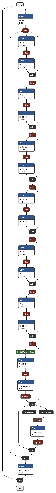

# 1. 请你将调研的每一篇文章体现在 markdown 文件中，需要看到对文章方法的理解和对你的启发

## 论文调研（一）：PReNet

**论文**：Progressive Image Deraining Networks: A Better and Simpler Baseline
**作者/出处**：Dongwei Ren 等，CVPR 2019｜arXiv:1901.09221｜官方代码：github.com/csdwren/PReNet

### 一、这篇文章想解决什么问题

单图像去雨是个病态问题：雨层和背景层混在一起、构成复杂，传统优化方法靠手工正则（稀疏、低秩等）刻画不清两层，性能有限。深度学习兴起后，方法越做越复杂——空洞卷积、dense 连接、SE 模块、多流结构、联合雨密度估计、混合损失加 GAN 损失全都堆上来了，带来两个毛病：一是**说不清到底哪个部件在起作用**，想在已有网络上继续改都无从下手；二是**损失一混合，调参负担爆炸**。另一类轻量方案又以明显掉点为代价。

作者于是提出**两个主张**，也正是标题里 "better and simpler baseline" 的含义：

1. 只组合少数几个模块，就能做出比当时更深更复杂的 SOTA 更好（指标、速度都赢）的模型；
2. 与早期 DerainNet/DDN "直接预测干净图很难训、必须先做高频分解"的结论相反——**网络本身变好之后，直接从雨图恢复干净图并不难训**。

### 二、方法理解

#### 整体结构：一个浅网络，递归跑 6 遍

PReNet 的本体只是一个浅层 ResNet，由三段组成：

- **f_in**：1 层卷积 + ReLU，做浅层特征提取
- **f_res**：5 个 ResBlock，做深层特征提取
- **f_out**：1 层卷积，把特征变回一张图

把这个小网络**在 6 个 stage 之间共享同一套参数、递归展开**，就是 PRN（Progressive ResNet）；再在 stage 之间加一个 ConvLSTM 传递状态，就是 PReNet。全网所有卷积都是 3×3、全程 32 通道、**不做任何下采样**，分辨率从头到尾不变。

#### 每个 stage 怎么工作

第 t 个 stage 做四件事（数据流）：

1. **拼接输入**：把上一 stage 的估计图 $x^{t-1}$ 和**原始雨图 y** 沿通道拼起来（3+3=6 通道），喂给 f_in 变成 32 通道特征。第一个 stage 没有上一 stage 的图，代码里就把 y 自己和自己拼。
2. **ConvLSTM 更新状态**：浅层特征先和上一个 stage 传下来的隐藏状态 h、细胞状态 c（都是 32 通道、和原图同分辨率，从 0 开始）做一次 LSTM 更新，得到这一 stage 的状态。注意它传的是**特征级状态**，和第 1 步的图像级拼接是两条不同的"记忆通道"。
3. **5 个 ResBlock 处理**：每个 ResBlock 是 Conv→ReLU→Conv，输出再与**本块的输入**原样相加、最后过一次 ReLU（相加发生在第二个 ReLU 之前）。
4. **输出负残差**：f_out（无激活）输出的结果与原图**相加**得到本 stage 的去雨图。也就是说网络实际学的是"干净图 − 雨图"，即负的雨层，加上原图即得干净图。

把上面四步（外加 f_in 这一步）连起来，一个 stage 的完整流程图是这样：

```text
[上一轮成果图 x^{t-1}] ＋ [原图 y]
        │  ① 通道拼接（cat），第一轮 x^{0} = y
        ▼
   6 通道输入
        │  ② f_in：Conv 6→32 ＋ ReLU
        ▼
   浅层特征（32 通道）
        │  ③ ConvLSTM 更新状态：汇入上轮 h^{t-1}、c^{t-1}（首轮全 0）
        │     → 算出新 h^t、c^t（存好传给下一轮 ← 特征级通道）
        ▼
   状态 h^t（32 通道）
        │  ④ f_res：5 个 ResBlock 串联
        ▼
   深层特征（32 通道）
        │  ⑤ f_out：Conv 32→3（无激活）
        ▼
   负残差 r^t（3 通道）
        │  ⑥ 与原图相加：x^t ＝ y ＋ r^t
        ▼
   本轮去雨图 x^t ──→ 回到顶部，成为下一轮的 x^{t-1}（← 图像级通道）
                      第 6 轮的 x^6 即整网最终输出
```

整网就是把这套流程用**同一组参数连跑 6 遍**（T = 6）：y → Stage 1 → x^1 → Stage 2 → x^2 → … → Stage 6 → x^6。每一轮之间同时传两样东西：成果图 x（图像级通道）和状态 h、c（特征级通道）。

其中第 ③ 步的 ConvLSTM 内部再展开，是这样一张图：

```text
ConvLSTM 一次更新的内部流程（stage 总图中“③ ConvLSTM 更新状态”的放大）：

输入三件：x（本轮浅层特征，32 通道）
          h^{t-1}（上轮隐藏状态，32 通道，首轮为 0）
          c^{t-1}（上轮细胞状态，32 通道，首轮为 0）

x ＋ h^{t-1}
   │  ① 沿通道拼接 → 64 通道（四个门共同的原料）
   ▼
四个门各过一个 Conv 64→32（都是 3×3 卷积，输出均为整张权重图）：
   f ＝ sigmoid(Conv)   遗忘门：旧账本每个格子留几成（0~1）
   i ＝ sigmoid(Conv)   输入门：新内容每个格子写几成（0~1）
   g ＝ tanh(Conv)      候选内容：准备写入账本的新内容本身（-1~1）
   o ＝ sigmoid(Conv)   输出门：账本每个格子取几成出来用（0~1）
   │  ② 更新账本：c^t ＝ f ⊙ c^{t-1} ＋ i ⊙ g（逐格相乘再相加）
   │     （c^{t-1} 不参加拼接，到这一步才登场）
   ▼
新账本 c^t
   │  ③ 取出状态：h^t ＝ o ⊙ tanh(c^t)
   ▼
新状态 h^t ──→ 送进本 stage 的 5 个 ResBlock 干活
h^t、c^t ──→ 存好，传给下一个 stage 当它的 h^{t-1}、c^{t-1}
```

直观效果（论文图 1）：第 1 个 stage 就去掉大部分雨纹，后面 stage 逐步清除残余——这就是标题里 Progressive 的含义，**指的是结构上逐 stage 渐进去雨，不是训练策略**（训练就是普通的分段衰减学习率，详见下文）。

#### 损失：极简到只有一个

- 默认损失只有一个：**负 SSIM**，而且**只监督最后一个 stage 的输出**，不管中间 stage。
- 论文还试了只监督最终输出的单 MSE（够用，但不如负 SSIM），以及给每个 stage 都加监督的"递归监督"——后者对最终指标**没有增益**，只是让中间 stage 的图更好看。作者借此把损失也做了减法：混合损失、GAN 损失一概不用。

#### 训练设置（消融实验所用）

- 数据：消融在 Rain100H 上做，且把原 1800 张训练图中与测试集背景相同的 546 张剔除、只用 1254 张训练（防数据泄漏）；评测集还有 Rain100L、Rain12、Rain1400。
- 超参：图像块 100×100、batch 18、Adam、初始学习率 1e-3、共 100 epochs、在第 30/50/80 个 epoch 把学习率乘 0.2；stage 数 T 最终选 6。

#### 实验结论与消融证据

最终成绩（PSNR/SSIM）：Rain100H 29.46/0.899、Rain100L 37.48/0.979、Rain12 36.66/0.961、Rain1400 32.60/0.946，全面超过 JORDER（Rain100H 26.54/0.835）和重训的 RESCAN（28.88/0.866，而且 RESCAN 用了全部 1800 张训练图、PReNet 只用 1254 张）。**整个模型参数量只有 168,963（约 0.17M）**，500×500 图推理 0.156 秒，也比 RESCAN 的 0.448 秒快。

消融分别证明了（都在 Rain100H 上）：

| 部件 | 证据 | 结论 |
| --- | --- | --- |
| stage 数 T | T 从 2 到 6 单调变好（27.27→29.32），T=7 略降 | T=6 是甜点，渐进迭代确实有用 |
| 每 stage 拼原图 y | 不拼 28.91 → 拼 29.46 | 几乎零成本的明确收益 |
| 跨 stage ConvLSTM | 无（PRN）28.07 → 有 29.46 | **单个部件里增益最大（约 +1.4 dB)** |
| 残差学习 vs 直接预测 | 直接预测 29.32 → 残差 29.46 | 残差略优，但直接预测也可行 |
| LSTM vs GRU | 29.32 vs 29.08 | LSTM 略优 |
| stage 内递归（_r 变体） | 只用 1 个 ResBlock 循环 5 次：参数降到 94,979，只掉约 0.5 dB | 参数预算紧时的好办法 |

### 三、对我的启发（为自建模型攒的积木块）

1. **"一个小网络递归多跑几遍"是小参数预算下的最优解之一**。参数不随深度涨（权重共享），却天然得到"先去大雨、再修残余"的迭代细化；我们自己的模型上限 4M 参数，这个思路可以把参数花在刀刃上。
2. **每 stage 重新拼回原始雨图**，等于每轮都让模型对照原图自查"哪里还有雨、哪里误删了背景"，成本只是输入卷积多 3 个通道。我们的 BaselineNet/DerainNet 都是"一锤子买卖"，没有这种反复对照机制。
3. **跨 stage 的记忆要用特征级状态，而不是只传图像**。上一轮的输出图信息量有限，ConvLSTM 的 32 通道状态能携带更丰富的中间判断——它是全篇增益最大的部件。若嫌 LSTM 四个门太重，可以先用 GRU 替代（论文里只差 0.24 dB）。
4. **输出用负残差相加**：网络只学"要改的那部分"，每个 stage 的输出都是合法图像，训练稳定、还能随时把中间结果画出来看去雨进程，对调试极其友好。
5. **先把单损失跑通再谈花样**。单一负 SSIM（甚至单 MSE）+ 只监督最终输出就能打赢一堆混合损失模型；多 stage 监督听起来美好但实测无增益。搭自己模型时应先立住这个极简版本，再逐个部件做加法并验证。
6. **方法论上的启发**：作者剔除与测试集同背景的训练图、每个部件都配一张消融表——"做减法 + 给证据"比堆模块更有说服力。

**需要谨慎照搬的地方**：T=6 全分辨率展开的参数虽小、计算量并不小（等于浅网络跑 6 遍，还带全分辨率 LSTM 状态），轮数受限或显存紧时可以减 stage；另外它的全部结论建立在千级成对合成数据上，我们的训练集规模不同，部件收益的排序未必原样复现，需要自己的消融来确认。

## 论文调研（二）：SPANet

**论文名片**：Spatial Attentive Single-Image Deraining with a High Quality Real Rain Dataset，CVPR 2019。作者 Tianyu Wang、Xin Yang（共同一作）、Ke Xu、Shaozhe Chen、Qiang Zhang、Rynson W.H. Lau（通信作者），大连理工大学、香港城市大学。arXiv:1904.01538（v1 2019-04-02，v2 2019-08-18；本文以 v2 为准）。官方代码：chiukin/SPANet。

### 一句话核心思想

**"先检测、后去除"**：先算出一张"哪里有雨"的注意力图，并且**用真值直接监督这张图**，再用它给后面的残差块"划重点"——有雨的地方使劲去，没雨的地方少动手。论文的另一半工作是自建了一套约 2.95 万对的真实雨图数据集，解决了"真实雨没法定量评测"的问题。

### 为什么要做这篇：两个痛点

1. **合成雨不像真实雨**：已有方法只在合成数据上训，合成雨模拟不了真实雨纹的形状、方向、强度变化；按轻/中/重三档给雨分密度本身就难分，错分还会拖累去雨；用 Photoshop 混合模式或叠加雾效模拟全局雨效只适用于特定雨型，还会压暗背景丢细节。
2. **真实雨没有可定量的基准**：真实雨图和干净图没法同时拍到，所以以前只能定性看图对比，没法算分。

**支撑后面方法与数据集的两个观察**：雨滴高速下落，**不太可能一直盖住同一个像素**；被雨盖住的像素亮度会在**真实背景亮度之上波动**（雨纹倾向于提亮背景）。

### 整体结构

全卷积网络，输入一张雨图、输出一张去雨图，**不做任何下采样**，全程 32 通道。

```text
雨图 → conv_in（3→32）→ 3 个普通残差块
     → [SAM 算注意力图 → 3 个注意力门控残差块] × 4 组
     → 2 个普通残差块 → conv_out（32→3）→ 去雨图
```

- 残差块是 Bottleneck 式：1×1 卷积 → ReLU → 3×3 空洞卷积（空洞率 dilation=2）→ ReLU → 1×1 卷积；块外的残差相加在主干里做（`F.relu(块输出 + 输入)`）。
- 4 组里的 SAM 是**同一个模块复用**（代码里就是同一个 SAM1 被调用 4 次），即论文说的"权重共享"；但每组的注意力图都由当时的特征重新算，不是把第一张图沿用到底。
- 注意：论文图 5(b) 把"SARB×3＋SAM"并列只是组件罗列，**正文顺序是 SAM 先算图、再引导其后 3 个块**，代码也是这个顺序，不要读反。

### SAM：空间注意力模块（全文最值得抠的部分）

#### IRNN 是什么

IRNN 是用 ReLU 激活＋单位矩阵初始化的循环神经网络（引自 Le et al. 2015）。论文引用它的理由：易训练、擅长建模长程依赖、计算高效。关键要分清：**这里的"循环"是沿一张图内的空间方向递推，不是沿时间的循环**——没有 PReNet 那种跨 stage 传状态的东西。

#### 两轮四方向：注意力图的计算骨架

对特征图上每个位置，沿上、下、左、右四个方向做递推累积（代码 irnn_layer：四个逐通道 1×1 卷积分别管四个方向，每步把邻位的值累积过来再过 ReLU）：

- **第一轮（局部）**：每个位置只汇总水平／垂直邻域的信息，用于建模雨纹的局部物理特性。
- **第二轮（全局）**：同样的四方向操作再来一遍，上下文从整张特征图汇聚过来，得到全局感知的特征图。

#### 方向注意力：SAM 里另一条分支

SAM 里除了 IRNN 分支，还有一条"自注意力分支"（消融表里叫 Self-Attention branch）：它由两层 3×3 卷积＋一层 1×1 卷积＋sigmoid 算出 **4 通道权重图**，四个通道分别对应上、下、左、右四个方向。在每轮 IRNN 之后，四个方向图**各乘自己对应的那一通道权重**，再拼起来经 1×1 卷积融合。也就是说：方向不是等权重的，网络自己学"这个位置更该信哪个方向传来的信息"。

#### 成图与用法

- 两轮 IRNN＋方向加权之后，再经 1×1 卷积＋sigmoid，得到**单通道注意力图 mask（0～1 的空间权重图）**。
- **用法**：`out = F.relu(残差块(out) * Attention + out)`。即注意力图**逐元素乘在残差分支的输出上**，再与输入相加过 ReLU。打个比方：残差块是"动手干活的人"，注意力图是"工头的手势"——有雨的地方手势重、活全干，没雨的地方手势轻、活被压小，输入本身那条直通路始终保留。

#### 显式监督：这篇最便宜的大招

损失里有一项 **$L_{Att}$ = ‖A − M‖²**，其中 A 是**第一个 SAM**的注意力图（注意：只监督第一张，不是四张全监督），M 是二值雨图——由**雨图与干净图的差值阈值化**得到，1 表示该像素被雨覆盖、0 表示没被覆盖。

也就是说：只要训练数据自带干净图，这张监督图就是**免费算出来的，不需要额外标注**。注意力头不再是"自己悟"，而是"开卷考试"。

#### SAM 工作流程图

```text
SAM 工作流程（输入：进入该组的特征 x，32 通道）

x ──┬──→ 分支 A：方向注意力（算“信哪个方向”）
    │      conv 3×3 → ReLU → conv 3×3 → ReLU → conv 1×1 → sigmoid
    │      → 4 通道权重图 w（4 个通道分别对应上、右、下、左）
    │
    └──→ 分支 B：主干起点 conv 1×1（32→32）
            │
            ▼
       ① 第一轮 IRNN：四方向递推累积（局部）→ 4 张方向图
            │
            ▼
       ② 方向加权：每张方向图 × w 对应通道 → 拼成 128 通道
            → conv 1×1 融合回 32 通道
            │
            ▼
       ③ 第二轮 IRNN：四方向递推累积（全局）→ 4 张方向图
            │
            ▼
       ④ 方向加权（再用同一张 w）→ 拼成 128 通道
            → conv 1×1 融合回 32 通道 → ReLU
            │
            ▼
       ⑤ 成图：conv 1×1（32→1）→ sigmoid → mask（单通道，0~1）
            │
            ├──→ 其后 3 个 SARB 的门控
            └──→ 只有第一组的 mask 被主干返回，用于 L_Att 监督
```

#### SARB 工作流程（接在 SAM 后面）

```text
SARB 工作流程

输入两件：x（主干特征，32 通道；组内第一个 SARB 的 x 就是 SAM 前面的那份特征）
          mask（本组 SAM 产出的单通道注意力图，同一组内 3 个 SARB 共用）

x
│  ① Bottleneck 加工：1×1 卷积 → ReLU → 3×3 空洞卷积（空洞率 2）
│     → ReLU → 1×1 卷积 → 修正量（32 通道）
▼
修正量 × mask（逐元素相乘；mask 单通道广播到 32 通道）
│  ② 门控：有雨的地方修正量原样保留，没雨的地方被压小
▼
门控后的修正量 ＋ 输入 x（原样直通）
│  ③ 残差相加 → ReLU → 输出，送给下一个 SARB
▼
一组 3 个 SARB 跑完 → 下一组 SAM 重新算 mask → 再跑 3 个 SARB
（普通残差块与 SARB 的唯一差别：没有第 ② 步的 ×mask）
```

注意：SAM 只产 mask、不改动特征——SARB 的 x 是主干上一直流动的那份特征，不是 SAM 的输出；SAM 只是从主干上"取样"算 mask 的旁路。

### 损失与训练（arXiv v2 为准）

- 总损失：**$L_{total}$ = $L_1$ ＋ $L_{SSIM}$ ＋ $L_{Att}$**（式 6），其中 $L_{SSIM}$ = 1 − SSIM(预测, 干净图)。
- 框架 PyTorch；Adam；batch 16；数据增广为缩放与裁剪；学习率初值 0.005，30K iterations 后除以 10，共 40K iterations（论文给的是迭代数，不是 epoch 数）；硬件 4× Titan V。

### 真实雨图数据集：半自动生成

1. 对同一静态场景的 N 帧雨图序列，逐像素取**众数**近似背景亮度（依据就是前文两个观察：雨不长久盖同一像素、雨使像素变亮）；
2. 直接用众数会在稠密雨区出噪声，于是算众数的百分位范围，再找一条能穿过最多百分位区间的全局百分位来平滑（式 2～4）；
3. 人工评估把关：通不过就加帧重算。

- 帧数 N：稀疏／正常／稠密雨分别初设 **20／100／200 帧**，不通过则分别 **＋10／20／50 帧**，稠密雨可达 200～300 帧；故意从小帧数起步，因为帧越多越可能混入噪声、模糊、抖动。
- 规模与来源：**170 段真实雨视频**（84 段作者自拍 iPhone X 或 iPhone 6SP，86 段来自 StoryBlocks／YouTube），覆盖城市（楼宇、街道）、郊区（街道、公园）、野外（森林）；生成 **29,500 对：28,500 训练、1,000 测试**。
- 生成方法自测对比（表 1，10 段合成雨视频；**口径是每个方法取 PSNR 最高的一帧，括号内为平均值，51.40 是"最佳帧"口径，不要误读为平均值**）：

| 方法 | PSNR | SSIM |
| --- | --- | --- |
| 输入雨图 | 25.40 | 0.7228 |
| Jiang et al. | 32.79（平均 29.82） | 0.8827（平均 0.8566） |
| Wei et al. | 27.30（平均 25.71） | 0.9043（平均 0.8911） |
| Li et al. | 32.59（平均 30.59） | 0.9458（平均 0.9387） |
| **本文方法** | **51.40** | **0.9907** |

- 局限（论文 §6）：雾状大雨会失效——生成方法无法从雾蒙蒙的帧里选出干净像素，导致网络输出带雾感；生成依赖人工判断，作者称未来希望发展无监督生成机制。

### 定量结果（全部为本文自测数）

#### 表 2：自建真实测试集（1000 对）——本文主战场

| 方法 | PSNR | SSIM |
| --- | --- | --- |
| 雨图本身 | 32.64 | 0.9315 |
| DSC | 32.33 | 0.9335 |
| LP | 32.99 | 0.9475 |
| SILS | 33.40 | 0.9528 |
| Clear | 31.31 | 0.9304 |
| DDN（原始／重训） | 33.28／34.88 | 0.9414／0.9727 |
| JORDER（原始／重训） | 32.16／35.72 | 0.9327／0.9776 |
| DID-MDN（原始／微调） | 24.91／28.96 | 0.8895／0.9457 |
| RESCAN（原始／重训） | 30.36／35.19 | 0.9553／0.9784 |
| **SPANet** | **38.06** | **0.9867** |

- 括号内＝在自建数据上重训／微调后的数字；DID-MDN 仅微调（自建数据无密度标签，没法重训其密度分类网络）。
- 一个值得记的讨论：**雨图本身的分数（32.64／0.9315）高于多个去雨结果**，原因是这些方法在真实雨上过度去雨（over-deraining），把背景结构也抹掉了。去雨不是"去得越狠越好"，保住背景和去雨同样重要。

#### 表 3：DID-MDN 的合成测试集（SPANet 在该合成数据上训练，本文自测）

| 方法 | PSNR | SSIM |
| --- | --- | --- |
| 输入 | 21.15 | 0.7781 |
| DSC | 21.44 | 0.7896 |
| LP | 22.75 | 0.8352 |
| Clear | 22.07 | 0.8422 |
| JORDER | 24.32 | 0.8622 |
| DDN | 27.33 | 0.8978 |
| JBO | 23.05 | 0.8522 |
| DID-MDN | 27.95 | 0.9087 |
| **SPANet** | **30.05** | **0.9342** |

#### 特别提醒：本文没有 Rain100H／Rain100L／Rain1400 的成绩

### 消融（表 4，自建真实测试集）

| 变体 | 含义 | PSNR | SSIM |
| --- | --- | --- | --- |
| Ba | 纯 ResNet 基线（无 SAM） | 37.43 | 0.9856 |
| Bb | 单个 SAM 用 4 次 | 37.43 | 0.9854 |
| Bc | 4 个 SAM，不共享权重 | 37.47 | 0.9854 |
| Bd | 4 个 SAM 共享权重，但去掉 self-attention branch | 37.70 | 0.9858 |
| Be | 共享权重＋branch，但去掉 attention loss | 37.39 | 0.9856 |
| **Bf** | **完整 SPANet** | **38.06** | **0.9867** |

- 配对增益：共享权重 vs 不共享 **＋0.59 dB**（Bf vs Bc）；attention branch **＋0.36 dB**（Bf vs Bd）；attention loss **＋0.67 dB**（Bf vs Be）；完整版 vs 基线 **＋0.63 dB**（Bf vs Ba）。
- **正文概括与表格数字不完全吻合**：正文称"所有 SAM 变体都提升了性能"，但数字上 Bb 与基线持平（37.43＝37.43，SSIM 还微降），Be（37.39）甚至低于基线。也就是说，SAM 的收益是**组合生效**的，单拎一项未必有用。
- 消融各变体并非严格单因素对照（Bb／Bc 同时含 branch＋loss），增量只能按上述配对关系理解。

### 对自建模型的启发

#### 成本低、值得借鉴

1. **"注意力图显式监督"是最便宜的大招**：只要训练数据有干净图，就能用 |雨图 − 干净图| 阈值化免费造出二值雨图 M来当注意力头的监督真值。实现上只是一个单通道 sigmoid 头＋一项 ‖A−M‖² 损失，参数代价几乎为零；消融显示 attention loss 单项值 **＋0.67 dB**，是 SPANet 消融里最大的单项增益。给 MyModel 加一个这样的辅助头性价比极高。
2. **注意力模块权重共享**：一个 SAM 的权重在多个阶段复用，消融显示比不共享 **＋0.59 dB**，参数不增反"赚"，对 ≤4M 参数上限非常友好。
3. **门控残差块可简化接入**：`残差分支输出 × 注意力图 ＋ 输入`的写法，和现有 BaselineNet／DerainNet 的残差思路同构，迁移零成本；可以先以简化版空间注意力（普通卷积＋sigmoid，不上 IRNN）接入现有代码验证收益。
4. **空洞卷积扩感受野**：代码里 Bottleneck 中间 3×3 卷积的空洞率是 2，不降分辨率、不增参数地扩大视野，适合雨纹这种长条结构；但具体空洞率组合仍应在小规模上自己试 1／2／4 这类常规组合，不要照抄。

#### 贵或风险大、要谨慎

1. **两轮四方向 IRNN 不要全量照搬**：官方实现是逐方向递推累积的写法，且代码基于老 PyTorch 0.4 环境；在现代 PyTorch＋Windows 环境下复现成本高、易踩坑。更现实的是先做简化版注意力验证收益，再决定是否上 IRNN。
2. **不要单拎一个积木就指望涨点**：表 4 是现成的反例——单个 SAM 几乎无增益（Bb＝Ba），去掉 attention loss 反而跌破基线（Be＜Ba）。这套积木是"组合生效"的，恰好也是任务5.2"照搬文中模块反而降点"的绝佳例证：借鉴时必须成组验证（SAM＋共享＋attention loss 一起上，再逐项消融）。
3. **真实雨数据集的思路对本次任务不现实**：众数＋人工逐图把关需要视频序列和大量人工，不适合任务时间；但其中"用 |雨−净| 阈值化造二值雨图当监督"的 trick 可以直接偷走。
4. **训练成本要打折**：原文 40K iterations、batch 16、4 卡 Titan V；自己单卡、200 轮的预算下，应把 SAM 做成轻量版（例如只在 1～2 个阶段放共享 SAM），而不是 4 组全量复现。
5. **注意任务约束冲突**：SPANet 原文损失含 L1＋SSIM 项，与任务"只能用 L2 Loss"的总要求不在同一规则下；借鉴其注意力监督思想时，损失形式要按任务规则调整，不能直接照搬三项损失。

## 论文调研（三）：MPRNet

**论文名片**：MPRNet: Multi-Path Residual Network for Lightweight Image Super Resolution，WACV 2021，pp. 2704-2713。作者 Armin Mehri、Parichehr B. Ardakani、Angel D. Sappa，巴塞罗那计算机视觉中心（CVC／UAB）、ESPOL 理工大学。arXiv:2011.04566。DOI：10.1109/WACV48630.2021.00275。

### 一句话核心思想

**“用便宜的办法把多路信息都留住，再用注意力把有用的放大”**：主干不靠堆很深很宽的卷积，而是让每个残差块走多条学习路径（空间、平滑、直通），再把不同深度的块拼起来用 1×1 卷积融合，最后用一个同时看通道和位置的注意力模块把关键信息提出来。目标是在参数量只有 538K 的前提下，追平甚至超过参数量大几倍的重型超分辨率网络。

### 为什么要做这篇：轻量超分辨率的痛点

1. **重型网络精度高但用不起**：EDSR、RDN 这类网络靠加深加宽、去掉 BN、堆残差和密集连接提 PSNR，代价是参数和计算量暴涨，容易过拟合，也放不进手机、电视、便携设备这类真实场景。
2. **早期轻量网络精度不够**：SRCNN、FSRCNN、ESPCN 把上采样挪到网络末尾省了计算，但层数不够、精度掉下来；CARN 用级联残差省参数也要以掉 PSNR 为代价。
3. **MobileNet 式瓶颈在超分辨率里会丢信息**：倒置残差把特征先压窄再放宽，窄的那段容易造成梯度混淆、丢高频信息，而超分辨率恰恰最需要高频细节。

所以这篇的打法不是“再堆一层大的”，而是“把每块的内部结构改便宜、改多路，再把注意力做轻”。

### 整体结构：四个模块串联

```text
低分辨率图 I_LR
  │
  ▼
① 浅层特征提取 SFE：1 层 3×3 卷积 → H_SFE
  │
  ▼
② 残差模块 RM：若干个残差拼接块 RCB 串联
  │  每个 RCB 里含若干个自适应残差块 ARB
  │  RCB 内部有局部残差连接 LRC，RM 整体有全局残差连接 GRC
  │  每块的输出拼起来 → 1×1 卷积融合 → H_RM
  ▼
③ 特征模块 FM：TFAM 精炼 H_RM → 全局特征提取 GFE
  │  ＋ 长程跳连 LRSC（浅层信息直通到高层）
  │  → H_FM
  ▼
④ 多尺度上采样 UP-Net：受 CARN 启发的上采样模块
  │  （像素重排式上采样）→ 再经 1 层卷积重建
  ▼
高分辨率图 I_SR
```

论文给出的六个式子就是这条链（式 1 是 SFE，式 2 是 RM 的拼接定义，式 3 是 RCB 的拼接定义，式 4 是 FM = GFE(TFAM(RM)) ＋ 长程跳连，式 5 是 UP-Net 上采样，式 6 是重建卷积出 I_SR）。注意：这里的“多路”（Multi-Path）不是“多阶段”，而是**块内多路＋块间多级拼接**，和 PReNet 的多 stage 递归、Zamir 的多 stage 渐进都不是一回事。

### ARB：自适应残差块（全文最值得抠的积木）

ARB 不像普通残差块只有一条“卷积→激活→卷积→相加”的路，它是**三条路并行、最后汇合**：

```text
ARB 工作流程

输入特征
  │
  ├──→ ① 瓶颈路 BN：深度卷积 Dw 3×3（提空间信息）
  │      → 逐点卷积 Pw 1×1（混通道、降计算量）
  │      → 再 Dw → 再 Pw …（同通道数、同分辨率，不突然变宽）
  │      → 在第二个 Dw 之后接 TFAM（见下文）
  │
  ├──→ ② 自适应路 Adp：全局平均池化 → 1×1 Pw 卷积
  │      作用：把每张特征图平均一下，平滑、去噪、降维，
  │      但保留重要信息，让网络在带噪低分辨率图上也稳
  │
  └──→ ③ 残差路 Res：直接放在高维特征上直通
         作用：不像 MobileNet 那样把残差路夹在窄特征里，
         高维直通能传更多信息、梯度更好流
  │
  ▼
BN 路和 Res 路先汇合 → 再经一层 Dw 卷积（论文强调这层很关键，
再学一轮空间信息）→ 最后和 Adp 路汇合 → 输出
```

为什么这样设计，论文给了三个理由，对应三条路：

- BN 路用 **Dw＋Pw（深度可分离卷积）** 代替普通卷积：Dw 只在每个通道内做空间卷积，Pw 只做 1×1 通道混合，两步拆开比一步普通卷积便宜得多，又能学到空间＋通道两类信息；
- Adp 路用平均池化：低分辨率图常带噪，平均一下能平滑噪声，相当于给网络一个“先看大势”的稳定信号；
- Res 路放在高维：窄瓶颈会丢信息、混淆梯度，高维直通是这篇对 MobileNet 瓶颈的直接修正。

### TFAM：双重注意力模块（Two-Fold Attention Module）

TFAM 同时回答两个问题：**通道上“什么重要”（what），空间上“哪里重要”（where）**，由两个单元拼成：

```text
TFAM 工作流程

输入特征
  │
  ├──→ 通道单元 CA：全局平均池化（一阶统计）
  │      → 两路并行卷积，各看一半通道、各出一半通道
  │      → 拼回完整通道数（这样比一整路卷积便宜）
  │      → 得到逐通道权重
  │
  └──→ 位置单元 Pos：平均池化 ＋ 最大池化（都用大核）
         → 拼成空间描述子 → 上采样恢复尺寸
         → 卷积 → 得到空间注意力图
  │
  ▼
两路信息汇合 → 1×1 卷积恢复通道数 → sigmoid 出最终掩码
  → 掩码 × 输入特征 → ＋残差直通 → 输出
```

和常见注意力的区别，论文在消融里特意对比过：

- SE 只看通道，CBAM 虽然通道＋空间都看，但它的通道单元用了最大池化，论文称这会丢通道信息，在这篇的实验里 CBAM 甚至不如基线；
- CSAR、ESA 也都是通道＋空间，但 TFAM 在通道单元用**一阶统计（平均池化）**、在位置单元用**平均＋最大池化沿通道轴**拼描述子，论文认为这样更能突出边缘这类重要特征；
- TFAM 还被塞进两个地方：ARB 的瓶颈路里（第二个 Dw 之后），以及特征模块 FM 里（RM 之后、GFE 之前），是“块内＋模块间”两级精炼。

### 三种残差连接，别混成一种

论文在消融表 6 里拆了三种连接，名字很像：

| 连接 | 全称 | 位置和作用 |
| --- | --- | --- |
| LRC | 局部残差连接（Local Residual Connection） | RCB 内部，块内 ARB 之间的残差；论文指出，单用 LRC 时 1×1 卷积的乘性操作会干扰优化，效果甚至略低于无连接基线 |
| GRC | 全局残差连接（Global Residual Connection） | RM 整体，把各 RCB 的输出拼起来、经 1×1 卷积融合后传下去；单用 GRC 比基线好，因为它把中层到高层的信息都收集起来了 |
| LRSC | 长程跳连（Long-Range Skip Connection） | 从浅层（SFE 附近）直通到 FM 末尾，保证高层在进 UP-Net 之前还能拿到“没被改过的”原始信息，也可以缓解梯度消失／爆炸 |

三者全开时最好（表 6，见下文），说明这篇的“多路”不只是 ARB 内部三路，还包括**块内、模块间、浅层到深层**三层连接。

### 定量结果（论文表 1，BI 退化，轻量模型对比）

参数量／计算量口径：表头是 ×4 倍数、按生成 720P 图算 Multi-Adds。MPRNet 是 **538K 参数、31.3G Multi-Adds**，在表里是计算量最低的一档（LatticeNet 777K／43.6G，CARN 1592K／90.9G，RDN 这类重型模型在 BD／DN 对比里被论文称为约 44 倍于 MPRNet 的代价）。

| 数据集 | ×2 | ×3 | ×4 |
| --- | --- | --- | --- |
| Set5 | 38.08／0.9608（LatticeNet 38.15 略高） | **34.57／0.9285** | **32.38／0.8969** |
| Set14 | **33.79／0.9196** | **30.42／0.8441** | **28.69／0.7841** |
| B100 | 32.25／0.9004（LatticeNet 32.25 持平） | **29.17／0.8073** | **27.63／0.7385** |
| Urban100 | **32.52／0.9317** | **28.42／0.8578** | **26.31／0.7921** |

- Urban100 上优势最明显，论文的解释是 Urban100 结构纹理丰富，正好能体现“多级特征累积＋空间信息聚焦”的好处，SSIM 高也说明结构保得好。

#### BD／DN 退化（论文表 2，×3，摘要版）

- BD（模糊＋下采样）：MPRNet 和重型 RDN 基本打平，例如 Set5 都是 34.57，Urban100 是 28.31 对 28.46（RDN 略高）；
- DN（下采样＋噪声）：MPRNet 在多数集上反超 RDN，例如 Set5 是 28.54 对 28.46，Urban100 是 25.00 对 24.92，但 Set14 是 26.25 对 26.60（RDN 高）。所以不能写成“全面超过 RDN”，准确说法是“**以约四十分之一的代价，在 BD／DN 上和 RDN 互有胜负**”。

### 消融（全部是超分辨率集上的数，不能搬到去雨上）

#### 表 4：注意力模块对 MPRNet 本身的影响（×4）

| 模块 | Set14 | Urban100 |
| --- | --- | --- |
| 无注意力（基线） | 28.57 | 26.19 |
| SE | 28.59 | 26.21 |
| CBAM | 28.54 | 26.18 |
| CSAR | 28.61 | 26.23 |
| ESA | 28.64 | 26.25 |
| **TFAM（本文）** | **28.67** | **26.29** |

TFAM 比基线高 **＋0.10 dB**，比次优的 ESA 高 ＋0.03 dB。增益是真实但不大的。

#### 表 3：TFAM＋ARB 搬到别的骨干上（×4）

把 TFAM 和 ARB 加到 EDSR／RCAN／MSRN 的块末尾（放在原来 RCAN 通道注意力的位置），三条骨干的 Set5（×4）和 Urban100（×4）都涨了：表内 Set5 一列从 32.46（EDSR 基线）一路升到 32.78（最高一档），Urban100 从 26.64 升到 26.96（表内分骨干、分注意力／残差块两档列出，中间档的具体归属以表 3 原表为准，这里只取两端和“都涨”这个结论）。

- 这说明 **ARB＋TFAM 是可插拔的积木，不只对 MPRNet 自己有效**，这是对自建模型最有用的一个证据。

#### 表 5：残差块本身和 ARB 三条路（×4）

| 配置 | B100 | Urban100 |
| --- | --- | --- |
| MobileNet 瓶颈块 | 27.24 | 25.79 |
| EDSR 残差块 | 27.44 | 25.96 |
| RCAN 残差通道块 | 27.52 | 26.08 |
| ARB 只有瓶颈路 | 27.46 | 26.05 |
| ARB 瓶颈＋自适应路 | 27.58 | 26.15 |
| ARB 瓶颈＋残差路 | 27.55 | 26.11 |
| **ARB 三路全开** | **27.63** | **26.31** |

三路全开比单瓶颈路高约 ＋0.17／＋0.26 dB，比 RCAN 块高约 ＋0.11／＋0.23 dB。

- 说明三条路是**叠加生效**的，单拎一条路（尤其只留瓶颈路）还不如 RCAN 块。

#### 表 6：三种残差连接（×3）

| 配置 | Set5 | Urban100 |
| --- | --- | --- |
| 无连接（基线） | 34.42 | 28.30 |
| 只有 LRC | 34.40 | 28.29 |
| 只有 GRC | 34.47 | 28.35 |
| 只有 LRSC | 34.45 | 28.33 |
| LRC＋GRC | 34.52 | 28.38 |
| **三者全开** | **34.57** | **28.42** |

全开比基线高 ＋0.15／＋0.12 dB。单用 LRC 反而微降，这个反直觉的点值得记：**不是连接越多越好、也不是每种连接单拎都正向，是组合起来才把 1×1 融合的优化问题抵消掉**。这和 SPANet 消融里“单 SAM 不涨、组合才涨”是同一个教训。

### 对自建模型的启发

#### 成本低、值得借鉴（积木层面）

1. **ARB 的三路思想可以直接搬到 MyModel 的残差块里**：瓶颈路用 Dw 3×3＋Pw 1×1 代替普通 3×3 卷积，参数和计算量立刻下来，对 ≤4M 上限非常友好；再加一条全局平均池化＋1×1 的自适应路平滑噪声、一条高维直通路保梯度。这三路在超分辨率上是叠加生效的，去雨里雨纹也是空间结构＋噪声的混合，值得先做一个小规模对照（普通残差块 vs ARB 式块）验证，不要直接全量替换。
2. **TFAM 的“通道＋位置”双单元**：去雨恰恰需要“哪里有雨”（位置）和“哪个通道的雨纹更重”（通道）两个判断，TFAM 的结构比只用通道注意力（SE／CAB）更对口。实现上可以先做简化版：通道单元用平均池化＋两路分半卷积，位置单元用平均＋最大池化拼描述子，最后 1×1＋sigmoid 出掩码、乘特征、加直通路。
3. **多级拼接＋1×1 融合**：把不同深度块的输出拼起来再用 1×1 卷积压回原通道数，是比“只用最后一层特征”更稳的做法，和 UNet 的跳连是同一类思想，写进 MyModel 时几乎零成本。
4. **三层残差连接的组合意识**：块内残差、模块间残差、浅层到深层的长程跳连要**成组上**，单用局部残差在表 6 里甚至微降。搭模型时先把三者都留好开关，再逐项消融，别只加一种就下结论。
5. **轻量预算的参照**：全网 538K 就能在超分辨率上追平重型模型，说明课程 ≤4M 的上限其实很宽裕。自建模型完全没必要一上来就堆到 3～4M，先用 Dw／Pw、1×1 融合、分半通道注意力把参数压下来，留出余量给宽度和深度调参。

#### 不能直接搬、要改写的地方

1. **UP-Net 必须删掉**：去雨是同分辨率进出，不需要上采样模块。借鉴时只借 SFE→RM→FM 这段，把 UP-Net 换成“最后 1 层卷积出残差、再与原图相加”的去雨头，和现有的 DerainNet／BaselineNet 的输出形式对齐。
2. **损失要按任务规则换**：本篇用 L1，任务一、二的总要求是只能用 L2。如果自建模型仍受 L2 约束，就把 L1 换成 MSE，结构照借、损失不照搬。
3. **评测口径不能混**：本篇 PSNR／SSIM 在 Y 通道上算，课程代码的 PSNR／SSIM 实现要按课程 utils.py 来，两个数不能直接比。
4. **数据和任务都不一样**：本篇训的是 DIV2K 超分辨率、退化是下采样／模糊／噪声，去雨训的是雨图对。ARB／TFAM 在超分辨率上 ＋0.10 dB 量级的增益，**不能写成“去雨能涨多少”**，只能作为“值得在去雨小规模上试”的候选，不能当结论。

## PReNet、SPANet、MPRNet 对比（只写确实可比处）

| 维度 | PReNet（去雨） | SPANet（去雨） | MPRNet（超分辨率） |
| --- | --- | --- | --- |
| 任务 | 去雨：从雨图恢复干净图，同分辨率进出 | 去雨：同上，另加自建真实雨数据集 | 超分辨率：从低分辨率图放大到高分辨率图，**输出尺寸大于输入**，最后必须有上采样模块 |
| “多”是什么意思 | 多 stage 递归：同一网络循环 6 次 | 多组堆叠：4 组 SAM＋门控块顺序堆叠 | 多路＋多级：块内三路并行、块间拼接融合、三层残差连接 |
| 注意力 | 无显式注意力头；靠 ConvLSTM 的状态传上下文 | 空间注意力：IRNN 算单通道空间掩码，乘残差分支；注意力图本身有二值雨图监督 | 双重注意力：通道单元（what）＋位置单元（where），掩码无单独监督，靠最终重建 loss 端到端学 |
| 残差形式 | 输出负残差，与原图相加 | 残差分支输出 × 注意力图 ＋ 输入 | 块内、模块间、浅层到深层三层残差＋拼接融合；最终是重建卷积出高分辨率图，不是“原图加减” |
| 轻量手段 | 参数共享递归，全网仅约 0.17M | 全程 32 通道、SAM 权重共享，第三方复测约 0.28M | Dw＋Pw 深度可分离卷积、通道单元分半卷积、1×1 融合，全网 538K |
| 损失 | 默认单负 SSIM，只监督最终输出 | L1＋SSIM＋注意力图 L2，三项 | **L1**，只监督最终高分辨率图 |

# 2. 调研单图像去雨的文章？那么应该怎么找到需要的文章呢？🤔请总结你寻找文章的方法

## 一、先定 scope，再动手搜

没定 scope 就搜，搜到的全是噪音。动手前先回答四个问题，写在纸上：

1. **任务边界**：只要单图像去雨，还是也看去雾、去噪、去模糊？复原类文章常把几个任务放一起，标题里有 restoration、deraining、deblurring 的要先看摘要确认主任务，别被标题带偏。
2. **要解决的具体问题**：是找整体架构、找注意力模块、找损失函数、找数据集，还是找对比基线？问题不同，关键词和筛选标准完全不同。
3. **可比性口径**：准备在哪个数据集上比？Rain100H、Rain100L、Rain1400、Test100、SPA-Data（真实雨图）上的分数不能直接混着排。
4. **能不能复现**：课程作业要搭自己的模型，优先找有代码、结构不依赖特殊算子、参数量可算的文章；只有图和公式、没有代码细节的文章先放后备区。

一句话原则：**先想清楚要什么，再去搜；搜到的第一任务是排除，不是收藏。**

## 二、关键词：中英文搭配，分三层拼

只搜“去雨”两个字会漏掉大半，英文关键词要分层组合：

| 层 | 关键词示例 |
| --- | --- |
| 任务词 | single image deraining、image deraining、rain removal、rain streak removal、derain |
| 方法词 | progressive、recurrent、multi-stage、attention、residual、multi-scale、transformer、diffusion、real rain |
| 场景词 | heavy rain、real-world、synthetic、benchmark、dataset |

拼法示例：

- `single image deraining progressive residual`
- `image deraining spatial attention real rain`
- `deraining multi-stage supervised attention`
- `single image deraining survey review`
- `deraining Rain100H PSNR SSIM`

技巧：

- 任务词 + 方法词拼，搜到的才是“能借鉴的文章”，不是“所有去雨文章”；
- 任务词 + 数据集名拼，搜到的就是“能在同一张表里比的文章”；
- 同一个意思换词再搜一遍：deraining、rain removal、rain streak removal 三个词的结果集并不完全重合；
- 加年份过滤时要小心：经典文章（如 PReNet 2019）不会因为年份老就没价值，筛选时按“引用量 + 是否被后续文章当作基线”判断，不按年份一刀切。

## 三、六个渠道，按这个顺序用

### 1. 先读综述，再读单篇

这是最省时间的一步。先搜 `single image deraining survey` 或 `image deraining review`，找一篇近年的综述，把去雨文章按“传统方法 / CNN / 注意力 / 多阶段 / Transformer / 真实雨图”分好类，记下每类的代表作和时间线。有了这张地图，后面单篇就不会迷路，也不会把不同年代、不同数据集的文章放在一起比。

综述的用法是“找线索”，不是“抄结论”：综述里的分类和代表作要去原文核对，综述里的分数不要直接引用。

### 2. arXiv：找原文和版本号

arXiv 是去雨文章最常用的首发地，搜 `arXiv deraining` 或直接在 arXiv 按 cs.CV、eess.IV 分类浏览。

注意三件事：

- **看版本**。同一 arXiv 号可能有 v1、v2，训练设置、表格数字可能不一样。任务一里 SPANet 的 v1 和 v2 训练设置就明显不同，引用训练细节时必须注明是哪个版本。
- **arXiv 只是预印本**，最终发表信息（会议、期刊、页码）要以发表版本为准。

### 3. Google Scholar / Semantic Scholar：顺藤摸瓜

这两个库的核心价值不是“搜”，而是“追”：

- **向后追（参考文献）**：打开一篇已经确认的好文章，看它的参考文献，里面一定有它站在谁肩膀上的文章。PReNet 的参考文献里就有更早的去雨和残差网络文章。
- **向前追（被引用）**：在 Google Scholar 点“Cited by”，或在 Semantic Scholar 看引用它的文章，里面就是“后来的人怎么改进它”，这是找“进阶文章”最可靠的办法。
- **看引用量和引用语境**：引用量高不一定适合，还要看引用它的文章是把它当基线、当对比，还是当改进对象。

### 4. Papers With Code：按任务和数据集反查

在 Papers With Code 上按任务（Image Deraining）或数据集（Rain100H、Rain100L 等）反查，能一次性看到“在同一个数据集上，哪些文章报了哪些分数、有没有代码”。用法：

- 先按数据集筛，再按分数排序，找出当前在该数据集上的代表性文章；
- 点进文章看它有没有官方代码链接、代码是不是原作者维护的；
- **分数只作线索，不直接当结论**：Papers With Code 上的分数可能来自第三方复现、评测口径（Y 通道还是 RGB、单模型还是分数据集模型）可能和原文不一样，引用前必须回原文表格核对。

### 5. 顶会顶刊 proceedings：按年份扫

去雨文章集中在 CVPR、ICCV、ECCV、AAAI，以及 TIP、TPAMI、IJCV 等期刊。办法不是一篇篇读，而是：

- 去会议官网按年份看 Oral / Poster 列表，标题含 deraining、rain、restoration 的先收进候选；
- 再用“标题 + 摘要”十分钟筛一遍（见第五节），只留 3～5 篇进精读；
- 会议文章通常比期刊文章新、比 arXiv 文章经过了审稿，适合找近两年的新方法；期刊文章通常更完整，适合找数据集和评测细节。

### 6. GitHub：用代码反推文章

搜文章标题、作者名、数据集名 + GitHub，经常能直接找到官方仓库。代码的价值有三点：

- 确认模型结构是不是真如论文图上画的那样；
- 判断复现成本：PyTorch 版本太老（如 0.4）、依赖已停更、没有训练脚本的，复现成本很高，课程作业里要慎选；
- 看 Issues 和 README：别人踩过的坑、作者给的训练细节，往往比正文实用。

## 四、数据集锚点法：换一个入口找文章

如果关键词搜到的文章太杂，换数据集当入口会干净得多：

1. 先定一个准备用的数据集，例如 Rain100H（重雨合成集）、Rain100L（轻雨合成集）、SPA-Data（真实雨图）。
2. 搜“数据集名 + deraining”，得到的就是在这个数据集上测过的文章，天然可比。
3. 再看这些文章的表格：它们在同一个数据集上和谁比、比赢了多少、是不是同一个评测口径。

这个办法还有一个好处：能顺带发现数据集本身的文章。SPANet 的一半工作就是自建了一个约 2.95 万对的真实雨图数据集，读数据集文章能同时理解“数据怎么来的、有什么局限”（例如雾状大雨失效），这对自己搭模型选数据很有用。

## 五、十分钟筛一篇：读之前先判死刑还是精读

每篇候选文章，先花十分钟过这六项，过不了就放进“不读”或“后备”：

1. **标题 + 摘要**：任务是不是单图像去雨？核心 idea 一句话能不能说清？说不清的先放后。
2. **结构图**：输入输出尺寸变不变？有没有上采样、多阶段、注意力这些我们关心的结构？结构图和正文对不上号的要警惕。
3. **表格**：在哪个数据集上测的？PSNR / SSIM 是在 Y 通道还是 RGB 上算的？是单模型还是每个数据集单独训的模型？口径不清的分数不要引用。
4. **消融**：有没有把每个模块单独拆开测？只报整体分数、不做消融的文章，借鉴时风险大，因为我们不知道涨点到底来自哪个模块。
5. **代码和参数量**：有没有官方代码？参数量、计算量给没给？课程要求 ≤4M 参数的，参数量没给的文章要先算一遍再决定。
6. **引用关系**：它是否引用了我们已经读过的文章？是改进它、还是只是把它当基线？能放进我们已有知识地图的文章，优先级高于孤立的文章。

筛完后只留三类：精读（核心方法 + 代码都要看）、泛读（只看 idea 和表格）、不读（先存档，不花时间）。

## 六、记录方法：一张表管住所有文章

找文章不做记录，等于白找。我认为可以用一张表，表的每行记录一篇文章，列固定为对比项：

| 文章 | arXiv / 发表 | 任务 | 一句话 idea | 数据集 | 关键分数（注明口径） | 代码 | 对自建模型的启发 | 状态 |
| --- | --- | --- | --- | --- | --- | --- | --- | --- |
| PReNet | arXiv:1901.09221 | 去雨 | 同网循环 6 次 + ConvLSTM 传记忆 | Rain100H 等 | 29.46 / 0.899（原文） | csdwren/PReNet | 残差 + 递归 | 已精读 |
| SPANet | arXiv:1904.01538 v2 | 去雨 | 先算注意力图再引导去雨 | 自建真实集 | 38.06 / 0.9867（原文） | chiukin/SPANet | 注意力显式监督 | 已精读 |
| MPRNet（Mehri） | arXiv:2011.04566 | 超分辨率 | 多路残差块 + 双重注意力 | Set5 等 | 32.38 / 0.8969（×4） | 正文未找到官方链接 | ARB / TFAM 积木 | 已精读 |

这张表的好处是：写自建模型报告时，“参考了哪篇、借了哪个模块、分数从哪来”都能直接查，不会到最后发现引用张冠李戴。

## 七、避坑清单

1. **版本不同**：arXiv v1 和 v2 的训练设置、表格可能不同，引用细节必须注明版本。
2. **第三方数字当原文数字**：别的文章表格里的复测数、Papers With Code 上的数、README 里的数，都不能直接当原文数，引用前回原文表格核对。
3. **评测口径混用**：Y 通道和 RGB、单模型和分数据集模型、合成集和真实集的分数不能放一张表比。
4. **项目页和 README 不可全信**：项目页可能 404，README 可能没有数字，代码可能是老版本。数字以论文 PDF 为准，结构以论文 + 代码交叉核对为准。
5. **“SOTA”要看限定词**：是在哪个数据集、哪个口径、轻量还是重型模型里 SOTA？脱离限定词的 SOTA 没有意义。
6. **只看标题就下结论**：标题里有 progressive、attention、multi-stage 的文章很多，progressive 可能是结构渐进（多阶段），也可能是训练策略，读摘要和结构图才能分清。

## 八、一个可以直接跑的工作流

1. 定 scope：写清任务边界、要解决的问题、数据集、能不能复现。
2. 读一篇综述，画出分类地图，记下每类 2～3 篇代表作。
3. 用关键词 + 数据集锚点法各搜一轮，收 15～20 篇候选。
4. 十分钟筛一遍，留 5 篇左右精读，其余存档。
5. 精读时做两件事：画结构流程图（像任务一里给 PReNet、SPANet、TFAM 画的那样），填上面那张记录表。
6. 用“向后追参考文献 + 向前追引用”各扩一轮，补上漏掉的直接前身和直接改进。
7. 停下来检查：记录表里有没有缩写撞名、版本不清、口径混用的地方？有就回原文核对，没问题再进入下一轮。

**停止条件**：当新搜到的文章都在重复我们已经知道的 idea、只是换了个模块名字，或者连续三篇都进不了精读，说明这一轮的找文差不多够了，先去读和搭模型，不要为了凑数量继续搜。

# 3. 调研文章时，想必会遇到英文看不懂、文章看不进去、理解不了作者的方法等问题。在面对这些问题时，你会怎么解决呢？🤔请总结你处理一篇文章的方法

## 一、先换一个目标：不是读懂每个词，是拿到四样东西

很多时候读不下去，是因为默认目标错了：以为要从第一页第一行开始、每个词都弄懂，才能往下读。实际上，任务和自建模型只需要从一篇论文里拿到四样东西：

1. **它解决什么问题**：输入是什么、输出是什么、难在哪里；
2. **核心 idea 一句话**：它和前人比，新在哪一步；
3. **结构怎么走**：数据从输入到输出经过了哪些模块、每步尺寸变不变；
4. **证据是什么**：在哪个数据集上、什么口径下、比基线高了多少、消融证明了哪个模块有用。

拿到这四样，这篇论文就算“处理完了”，可以进记录表。至于某段证明、某个推导、某个次要实验，当时看不懂可以先标记，以后再回头，不要让它堵住整篇的进度。

一句话总结：**先拿骨架，再补血肉；先问“这段是干嘛的”，再问“这句话每个词是什么意思”。**

## 二、3遍读法：每1遍只做一件事

不要一遍就想读透。把阅读拆成三遍，每遍目标单一，反而更快：

### 第1遍：10～15 分钟，只看“地图”

只看这些，不看正文细节：

- 标题、摘要、结论；
- 结构图（Architecture Figure）和它的图注（Caption）；
- 表格的表头和第一列：数据集、对比方法、指标；
- 小节标题：Introduction、Method、Experiments、Ablation。

读完要能回答：这篇是干嘛的？输入输出是什么？核心模块叫什么？如果答不上来，说明这篇可能不在我们的 scope 里，先放后备，不要硬读。

### 第2遍：30～60 分钟，只跟“数据流”

这一遍只跟一条线：**数据从输入到输出怎么走**。

- 每遇到一个模块，先问：输入尺寸是多少、输出尺寸是多少、变没变？例如 PReNet 全程 32 通道、不下采样；SPANet 全程 32 通道、不下采样；Mehri 的 MPRNet 最后有上采样，输出尺寸比输入大。
- 每遇到一个公式，先问：它是定义输出的式子，还是一个损失？不要先抠推导。
- 每遇到一个表格，先问：这张表是想证明什么？是整体比别人好，还是某个模块有用？

读完要能画出一张流程图（像任务一里给 PReNet 每个 stage、SPANet 的 SAM / SARB、Mehri 的 TFAM 画的那样），画不出来就说明第二遍还没过关，回去只补画不出来的那一段。

### 第3遍：按需精读，只读和自己任务有关的部分

第三遍不是从头读到尾，而是按问题去查：

- 要借鉴某个模块，就只精读讲那个模块的一节，外加它的消融表；
- 要引用某个数字，就只精读那张表和它的评测口径说明；
- 要复现代码，就对照官方代码读对应的一节，正文和代码对不上时以代码的实际行为为准，但引用时要注明是“代码版”事实。

三遍之间可以隔开，不用一次读完。第一遍筛掉的文章，不要进第二遍；第二遍画不出流程图的文章，不要进第三遍。

## 三、单词和长句：先分三类，再决定怎么处理

难论文的语言障碍通常不是生词多，而是三类东西混在一起：

### 1. 专业术语：建一张自己的术语表，不要现查现忘

例如：

| 术语 | 先记成什么 | 备注 |
| --- | --- | --- |
| residual | 残差：输出 = 加工结果 + 原输入 | 核心思想，不是“剩余物” |
| ablation | 消融：拆掉某个模块再测，看它到底有没有用 | 读表时最关键的词 |
| progressive | 渐进：分多步慢慢做 | 但要看是结构渐进还是训练渐进 |
| attention map / mask | 注意力图 / 掩码：一张权重表，决定哪里放大、哪里压小 | 0～1 之间，软权重，不是二值图 |
| baseline | 基线：不加新模块的原始版本 | 消融表里的参照物 |

建表的方法：每篇论文只记 10～20 个真正影响理解的词，记“在这篇里是什么意思”，不要抄词典的全部释义。同一词在不同文章里意思可能不同，记术语时必须带上文章名。

### 2. 缩写：第一次出现的地方一定有全称

英文论文的规矩是，缩写第一次出现时一般会给全称，例如 Two-Fold Attention Module（TFAM）。读的时候养成习惯：**第一次见缩写就翻回它第一次出现的地方，把全称抄到术语表里**，后面再见就不用猜了.

### 3. 长句：先找主干，再看修饰

英文论文的长句通常是“主句 + 一串从句 / 插入语”，先把主干抽出来，再看修饰部分补了什么条件。例如：

> “We propose a novel module, which contains Residual Concatenation Blocks that are connected to each other with a Global Residual connection.”

主干就是：We propose a novel module（我们提出一个新模块）。后面 which 引导的部分只是在说：这个模块里有残差拼接块、块之间用全局残差连接连起来。先抓住主干，整句就通了，剩下的修饰慢慢补。

实用技巧：

- 遇到逗号、分号、括号、which / that / where 引导的从句，先跳过去读主干，读完主干再回头看从句；
- 遇到被动语态（is proposed / is calculated / is supervised by），先把它翻成主动：“谁对谁做了什么”，例如 “is supervised by the clean image” 就是“用干净图来监督它”；
- 一段话读三遍还不懂，不要在原地死磕，先标记“第 X 页第 Y 段没懂”，继续往后读，后面的图、表、代码经常会把前面那段讲清楚。

## 四、公式：先问四个问题，不要先算

公式看不懂，通常不是数学不行，而是不知道每个符号在图里对应哪一步。每个公式先问四个问题：

1. **左边是什么**：是输出、损失，还是中间变量？
2. **右边每一项是什么**：输入、权重、上一阶段的结果，还是干净图？
3. **尺寸变没变**：输入输出的通道数、高宽变没变？例如 SPANet 的注意力图是单通道、广播到 32 通道；Mehri 的 TFAM 最后要恢复通道数。
4. **这一步在流程图里是哪一块**：公式能不能指到结构图上的某一个框？指不到，说明这段还没读懂，先回去看图。

举两个任务一里真实的例子：

- **SPANet 的 $L_{Att}$ = ‖A − M‖²**：A 是第一个 SAM 算出的注意力图，M 是由“雨图 − 干净图”阈值化得到的二值雨图，‖·‖² 是所有像素差的平方和。先把 A 和 M 的来源搞清，公式就只剩“让算出来的图尽量接近真值图”这一句话。
- **PReNet 的输出是负残差**：网络学的是“干净图 − 雨图”这个差值，再和原图相加。先搞清“学的是差值、不是直接学干净图”，后面的递归、ConvLSTM 才好理解。

## 五、图和表：先看图，再看字

英文论文里，图和表往往比正文更直观，阅读顺序应该是：

1. **结构图**：先看箭头走向，再看每个框的名字，最后看图注里对每个框的解释。结构图看懂了，正文的 Method 一节就只剩细节。
2. **效果图**：对比图里，重点看“别人错在哪、这篇对在哪”，例如 Mehri 文章里超分辨率的纹理方向，别人画错了、这篇画对了，这就是它方法的直观证据。
3. **表格**：先看表头（数据集、指标、口径），再看行（对比方法），最后看列（这篇的数字）。消融表要横着看：基线是多少、加一个模块涨多少、加两个模块涨多少、单加某一个反而降了没有（例如 SPANet 的单 SAM、Mehri 的单 LRC 都有不涨甚至微降的情况）。

读表时最容易踩的坑是“只看数字、不看口径”：Y 通道还是 RGB、单模型还是分数据集模型、合成集还是真实集，这些口径写在表注或实验设置里，不看口径就引用数字，到交作业时会出问题。

## 六、代码是第二篇正文：正文看不懂时，去看代码

如果某一段正文反复读不懂，优先去找官方代码，而不是反复翻译那一段。代码的好处是：

- 变量名、函数名、注释经常比正文更直白；
- 尺寸、通道数、调用顺序在代码里是写死的，不会像正文那样含糊；
- 可以直接跑一个小输入，看每一步的输出尺寸，验证自己的理解对不对。

用代码时也要注意：

- 代码版本可能比论文老（例如 PyTorch 0.4 时代的写法），读的时候按“它在干什么”理解，不要被老 API 卡住；
- 代码和正文不一致时，先记下来，引用时注明是“代码版”还是“论文版”，不要按自己的猜测统一。

## 七、翻译工具怎么用：当拐杖，不要当答案

机器翻译可以用来“快速知道这段大意是什么”，但有三条红线：

1. **术语不要照搬翻译结果**：机器翻译经常把 residual、ablation、mask 这类词翻得不准，术语以原文 + 自己的术语表为准。
2. **关键句子要回原文核对**：要引用、要写进报告的结论，必须回英文原文确认，不能只凭翻译结果下结论。
3. **不要全文翻译**：全文翻译一遍等于把三遍读法压缩成一遍，还容易把“翻译完了”误当成“读懂了”。正确用法是：卡住的段落先机翻看大意，再回原文按主干 + 术语表精读一遍。

## 八、卡住时的处理流程：不要原地死磕

给自己定一个规则：**一段话、一张图、一个公式，超过 15 分钟还没懂，就换方法，不要换时间**。按这个顺序换：

1. 回结构图：这段在图里对应哪个框？
2. 回表格：这段有没有对应的数字或消融？
3. 去代码：代码里这一步是怎么写的？
4. 去综述 / 博客 / 实现解析：别人是怎么一句话讲清这个 idea 的？（只作线索，结论回原文核对）
5. 标记后跳过：先把后面读完，很多时候后面的内容会把前面讲清；读完全篇还不懂，再集中问一次。

这个流程的好处是：卡住的地方不会堵住整篇，读完一遍后，真正剩下的难点通常只有一两个，可以集中解决，而不是整篇都糊着。

## 九、一篇论文的笔记模板：读完就填，不要读完再补

每篇论文读完，立刻填一张一页纸的笔记，不要等读了五篇再一起补。模板如下：

- **一句话**：这篇是干嘛的？核心 idea 是什么？
- **输入输出**：输入尺寸、输出尺寸、变没变？
- **流程图**：数据从输入到输出经过了哪几个框？（手画一张，哪怕很粗）
- **关键公式**：每个公式的左边、右边、尺寸、作用，各写一行；
- **数据集和分数**：在哪个数据集上、什么口径下、比基线高多少？
- **消融结论**：哪个模块最有用？哪个模块单用不涨？
- **局限**：作者自己说了什么局限？你看出了什么局限？
- **对自建模型的启发**：能借哪个模块？不能照搬什么？为什么？

填完这张纸，这篇论文才算“处理完”。以后写报告、搭模型时，直接翻这张纸，不用重读全文。

## 十、常见误区：这几条最容易浪费时间

1. **从第一行开始逐词读**：等于把论文当英语课文读，读到第三页就放弃了。先读地图，再跟数据流。
2. **以为看不懂就是英语差**：很多时候是结构没跟上、符号没对上图，不是单词不认识。先画流程图，再查单词。
3. **把作者的说法当结论**：作者说“我们的方法是最好的”，要看它是在哪个数据集、哪个口径下说的，消融表支不支持，不要直接抄进报告。
4. **把不同文章的同名东西当成同一个**：SAM、MPRNet、progressive 都是例子，记术语时必须带文章名。
5. **只读文字、不看图和代码**：图和代码往往比文字更准，文字看不懂时先去看图和代码。
6. **读完不做笔记**：读的时候觉得懂了，过一周再用时全忘了。一篇一页纸，当天填完。

## 读不下去的时候，先问自己：我是卡在单词、长句、公式、还是结构上？按上面对应的那一节换方法，不要笼统地觉得“这篇太难了”

# 4. “渐进式训练”是什么、为何成为范式、与出题人给定方法的异同、它的优劣在哪、科研是否应遵循范式

## 一、渐进式训练是什么

### 1. 一句话定义

渐进式训练不是一种模型，而是一种**训练日程**：训练开始时用比较容易、比较小的设置让模型先学会基本映射，随着训练推进，逐步把任务变难、把输入变大，直到覆盖测试时真正要面对的难度和尺寸。

在图像复原（去雨、去模糊、去噪）里最经典、最常被引用的版本，是 Zamir 等人在 Restormer（CVPR 2022，arXiv:2111.09881）§3.3 提出的 Progressive Learning：

> CNN 复原模型通常在固定尺寸的图像块上训练。 Transformer 在小块上训练时，可能学不到全局图像统计量，导致在测试时面对全分辨率图效果变差。为此，训练早期用较小的图像块、后期逐步用越来越大的图像块；用混合尺寸块训出来的模型，在测试时面对不同分辨率的图可能表现更好。

### 2. 具体长什么样：以 Restormer 的日程为例

Restormer 的完整训练是 300K 次迭代，AdamW，学习率从 3e-4 用余弦退火降到 1e-6，图像块尺寸和 batch size 按迭代次数成对变化：

| 阶段（按迭代次数） | 图像块尺寸 | Batch size |
| --- | --- | --- |
| 开始 | 128 × 128 | 64 |
| 92K 起 | 160 × 160 | 40 |
| 156K 起 | 192 × 192 | 32 |
| 204K 起 | 256 × 256 | 16 |
| 240K 起 | 320 × 320 | 8 |
| 276K 起 | 384 × 384 | 8 |

注意两个配套动作，缺一不可：

- **块变大，batch 就变小**：大块一张图算起来更贵、占显存更多，把 batch 缩小，才能让每一步的耗时和显存大致保持稳定，不至于越训越慢、越训越爆。
- **学习率不是分段重置，而是全程一条余弦退火曲线**：渐进改变的是输入尺寸和 batch，不是每到一个阶段就把优化器推倒重来。

### 3. “渐进”还可以渐进什么：同一词的三个变体

“渐进式训练”是一个总称，具体渐进的维度不同，效果和适用场景也不同，引用时要写清是哪一种：

| 变体 | 渐进的是什么 | 例子 |
| --- | --- | --- |
| 块尺寸渐进（Restormer 式，最常用） | 训练块从小到大，batch 从大到小 | 上表 |
| 难度渐进（课程学习式） | 样本从易到难 | 先训轻雨、再训重雨；先训合成雨、再训真实雨；先训小噪声、再训大噪声 |
| 分辨率渐进（生成模型式） | 图像分辨率从低到高 | ProGAN 等生成模型先训低分辨率、再逐步加层训高分辨率 |

在这里如果不加限定，一般指第一种（块尺寸渐进），因为它是图像复原领域里被引用最多、也最容易和出题人的固定尺寸训练直接对比的一种。后两种可以作为补充，但不能和第一种混着论证。

### 4. 一个直观的比喻

固定尺寸训练像是“一直用同一套 100 道小题练，考试却突然考大题”。渐进式训练像是“先用小题把基本功练熟、练快，再逐步换成大题练全局视野和细节保留”。小题的好处是练得快、一步的代价小；大题的好处是和考试更像。渐进式训练就是把这两段拼起来，而不是只选一段。

## 二、它为什么会成为范式

“成为范式”不是因为它被证明在所有情况下都最好，而是因为它同时解决了三个实际问题，又被后续工作反复沿用，具体有四条原因：

### 1. 解决了训练和测试尺寸的 mismatch

复原任务的测试图通常是全分辨率、尺寸各不相同，而训练为了省显存、省时间只能裁成小块。如果整个训练只用一种小块，模型学到的统计量（尤其是 Transformer 的全局注意力统计量）就偏向小块，测试时面对大图会水土不服。混合尺寸训练让模型在训练时就见过多种尺寸，测试时换尺寸也不慌，这是它最直接的理论动机。

### 2. 兼顾了速度和精度这对矛盾

只用大块训：精度可能高，但每一步慢、占显存大、收敛慢，前期大量时间花在“还没学会基本映射就啃大图”上。
只用小块训：每一步快、迭代多，但精度受限于小块的视野和统计量。
渐进式把两者拼起来：早期小块 + 大 batch，快速学会基本映射、快速迭代；后期大块 + 小 batch，补全局视野和细节。Restormer 原文也明确写了，减小 batch 就是为了“让每步耗时和固定块训练差不多”，即在不显著增加总时间的前提下拿到大块的好处。

### 3. 符合课程学习这个更老的直觉，且有实证支撑

课程学习的基本直觉是：先易后难比一上来就难更容易优化、更不容易陷入局部解。渐进式训练把这个直觉落到了“块尺寸”这个可操作的维度上。Restormer 及其后续工作在去雨、去模糊、去噪、超分辨率等多个任务上都报告了：混合尺寸训出来的模型比只用固定小块训的模型在测试时更好，而且这个策略被后续的复原模型（包括 MPRNet 的期刊版等）沿用，逐渐变成了“复原模型训练设置”里的默认选项之一。

### 4. 一旦成为默认比较口径，不用它反而显得不公平

当越来越多 SOTA 文章都用同一套渐进日程报分数时，后来的文章如果还用固定小块训，审稿人和读者会先怀疑“你的分数低是不是因为训练日程没跟上，而不是模型不行”。为了公平比较，大家被迫沿用同一套日程，这就是范式自我强化的部分：**它一开始是因为有效而被用，后来是因为大家都用而不得不被用**。

## 三、与出题人给定训练方法的区别与它的优劣

### 先弄清楚出题人给定的方法

- **模型**：单个模型端到端从头训（baseline / unet / derainnet / mymodel 四选一），没有预训练、没有分阶段冻结、没有多模型串联；
- **数据**：DerainDataset 的 train / test 划分，训练时 shuffle，整个训练过程用同一套数据处理（固定尺寸 / 裁剪、固定翻转规则），不按难度、尺寸分阶段；
- **超参数全程固定**：Adam，学习率默认 1e-4，**没有学习率调度**（没有余弦退火、没有分段衰减），batch size 默认 8，epochs 由命令行给定（默认 20，任务里常用 50、100、200）；
- **损失全程固定**：像素损失 MSE（即 L2），可选加 0.1 倍感知损失，权重训练中途不变；
- **评估与存档**：每轮结束在 test 集上算 PSNR / SSIM / LPIPS，PSNR 创新高才覆盖保存 `best_*.pth.tar`，只留一个最好检查点。

一句话概括：**固定设置、一次训到底、只按最终 PSNR 选最好的一轮**。这是一种“控制变量式”的训练：模型结构是唯一变量，训练设置是常量。

### 对比表

| 维度 | 出题人给定方法（固定式） | 渐进式训练（Restormer 式） |
| --- | --- | --- |
| 训练块尺寸 | 全程固定一种尺寸 | 从小到大分阶段增大（如 128 → 384） |
| Batch size | 全程固定（默认 8） | 随块增大而减小（如 64 → 8） |
| 学习率 | 全程固定 1e-4，无调度 | 全程余弦退火（如 3e-4 → 1e-6） |
| 训练阶段 | 不分阶段，一次训到底 | 按迭代次数分阶段，每阶段换块尺寸和 batch |
| 样本难度 | 不按难度排序，全程随机 shuffle | 隐含由易到难：小块 / 简单结构先学，大块 / 精细结构后学 |
| 总迭代量 | 由 epochs × 数据集大小 / batch 决定，任务中通常是几十上百轮 | Restormer 原版是 300K 次迭代，量级远大于课程训练 |
| 实现复杂度 | 极低：一个 DataLoader、一个循环就能跑 | 较高：要按迭代次数切换 DataLoader 的块尺寸和 batch，还要协调学习率曲线 |
| 目标 | 让不同模型在同一套简单设置下可比，突出模型结构本身的差异 | 在追求 SOTA 时，让模型更好地适应全分辨率、多尺寸测试图 |

### 各自的优点和缺点

**出题人给定方法的优点：**

1. **简单、可复现、可比**：所有模型（baseline、UNet、DerainNet、自建模型）都在同一套设置下训，分数差异基本可以归因于模型结构，而不是训练技巧，适合课程教学和模型间比较。
2. **实现和调试成本低**：不需要写分阶段切换逻辑，不容易在阶段交界处出 bug，也不需要调阶段边界、块尺寸序列这些新超参数。
3. **适合小模型、小数据、单卡**：课程模型参数量在 ≤4M 量级、训练轮数只有 50～100 轮，固定式训练已经足够让模型收敛，渐进式带来的额外收益可能被小数据和短训练稀释。

**出题人给定方法的缺点：**

1. **训练和测试的尺寸 mismatch 没处理**：模型只见过一种尺寸的块，测试时如果图更大、结构更复杂，全局视野和统计量可能跟不上。
2. **大块的好处拿不到**：如果模型本身有较大的感受野或全局注意力，只用小块训会限制它学全局信息的能力，这正是 Restormer 提出渐进式训练要解决的问题。
3. **学习率没有调度**：全程固定学习率在后期容易在最优点附近震荡，不如余弦退火那样后期精细收敛（但这点和渐进式训练本身是两回事，不能把“余弦退火的好处”全算到“渐进”的头上）。

**渐进式训练的优点：**

1. **更好地适应多尺寸测试图**：混合尺寸训练是它最硬的收益，尤其对 Transformer、大感受野模型。
2. **速度和精度的折中更好**：早期小块快、后期大块准，总时间不比全程小块训多太多。
3. **符合由易到难的优化直觉**：先学会基本映射再学细节，收敛过程通常更稳。

**渐进式训练的缺点和风险：**

1. **超参数变多了**：阶段边界、块尺寸序列、batch 序列、学习率曲线都要调，调不好反而比固定式更差，阶段交界处还可能出现损失突升。
2. **后期小 batch 带来梯度噪声**：块变大、batch 变小是配套的，但小 batch 本身会让梯度估计更 noisy，需要配合学习率调度才能稳住。
3. **收益依赖模型和任务**：对小感受野的 CNN、小数据集、测试尺寸固定的任务，渐进式的收益会小得多；把 Restormer 在 Transformer 上的收益直接搬到课程小 CNN 上，是没有保证的。
4. **比较容易失真**：如果两篇论文一个用了渐进、一个没用，分数差异可能来自训练日程而不是模型，公平比较时必须把训练日程也对齐，这一点在引用 SOTA 分数时要特别小心。
5. **实现成本和总计算量不低**：Restormer 原版 300K 次迭代、后期大块的计算量，对任务的单卡、短训练来说并不便宜，不能只看“每步耗时差不多”就以为总成本差不多。

### 一个关键区分：不能把三件事混成一件

- **渐进式训练**（块尺寸 / 难度渐进）≠ **余弦退火学习率**（学习率调度）≠ **多阶段架构**（PReNet / Zamir 的多 stage 模型）。
- 渐进式训练可以配余弦退火，也可以不配；多阶段架构可以端到端训，也可以分阶段训。论证时要分开说：Restormer 的收益里，有一部分来自混合尺寸，有一部分来自余弦退火和长训练，不能全归因于“渐进”这两个字。

## 四、科研是否应遵循范式

结论先说：**不应该盲目遵循，应该有条件地遵循，并且要把范式当作“对照组”，而不是“标准答案”。**

### 1. 什么时候应该遵循

- **目标是刷 SOTA、和最新工作公平比较时**：如果同行都用渐进式日程报分数，我们不用同一套日程，分数就没有可比性，这时遵循范式是“为了公平”，不是“为了正确”。
- **模型本身需要大视野 / 全局统计量时**：例如 Transformer、大感受野模型、测试图是全分辨率且尺寸多变，渐进式训练的理论动机直接对上我们的模型，这时它值得作为默认选项。
- **有足够算力和时间做完整日程时**：能跑完 300K 量级迭代、能调阶段边界和学习率曲线，渐进式才有机会兑现收益；跑不完、调不稳，强行跟范式反而更差。

### 2. 什么时候不应该盲目遵循

- **目标是做模型结构的消融、教学、课程作业时**：出题人给定方法的价值恰恰在于“控制变量”。这时如果擅自改成渐进式，分数涨了也说不清是模型好还是训练好，反而破坏了实验的干净程度。课程里也明确说了“渐进式训练改造不作要求”，就是这个道理。
- **模型小、数据小、测试尺寸固定时**：渐进式的核心收益（适应多尺寸、学全局统计量）在这种 setting 下本来就小，强行上渐进式是“用大炮打蚊子”，还多了调参成本。
- **范式本身没有在我们的 setting 下验证过时**：Restormer 的证据主要来自大模型、高分辨率、多任务，不能自动推广到“课程小 CNN + 小去雨数据集 + 50 轮训练”。没有在自己的模型和数据上做过“固定 vs 渐进”的对照，就不能默认渐进一定更好。

### 3. 正确的科研态度：把范式当对照组，而不是当真理

范式在科研里的正确位置应该是这样的：

1. **先理解它为什么有效**：是解决了尺寸 mismatch、还是只是余弦退火和长训练的功劳？把原因拆开，才能判断它对我们的问题还成不成立。
2. **做对照实验，而不是口头站队**：在自己的模型和数据上，用相同的总计算量（或相同的总迭代次数）跑两组，一组固定式、一组渐进式，只变训练日程，看分数到底差多少。如果渐进式没涨，就如实报告“在该 setting 下渐进式无显著收益”，这本身就是一个有价值的结论，比强行说“范式就是好”更有科研价值。
3. **改进范式，而不是重复范式**：范式的下一代往往来自“发现范式在什么情况下失效”。例如，如果发现渐进式在小数据上反而让后期小 batch 更不稳，提出一种更稳的 batch / 学习率配套策略，这比第十篇“我们也用了渐进式训练”更有意义。
4. **写论文时诚实标注**：用了渐进式，就写清块尺寸序列、batch 序列、阶段边界、学习率曲线；没用，也写清是固定式设置。让读者能复现、能判断分数差异到底来自模型还是训练，这是对范式最基本的尊重，也是对自己工作最基本的保护。

## 参考

- Zamir, S. W., et al. Restormer: Efficient Transformer for High-Resolution Image Restoration. CVPR 2022, arXiv:2111.09881. §3.3 Progressive Learning，及训练设置（300K 迭代，块尺寸 / batch 对，余弦退火）。
- Zamir, S. W., et al. Learning Enriched Features for Fast Image Restoration and Enhancement. IEEE TPAMI（MPRNet 期刊版），其中对固定块与渐进块的速度 / 精度权衡有相同论述。
- Bengio, Y., et al. Curriculum Learning. ICML 2009. 课程学习（先易后难）的原始出处，Restormer 原文明确说渐进式学习与此类似。
- 任务中 main.py：Adam lr 1e-4 无调度、batch size 默认 8、MSE 像素损失、每轮评估并按 PSNR 保存最好检查点。本文对出题人方法的描述均以该文件为准。

# 5. 搭建属于自己的模型

## 1. 根据学习到的知识，在 MyModel 文件中搭建属于自己的模型

### 1. 模型已搭好，在models文件夹中，名为my_model.py

### 2. 学习使用 ONNX，创建并编写一个简单的计算模型参数的代码，运行后在 <https://netron.app/> 中运行，你将看到你的“模型大厦”的结构

#### 已编写好export_onnx.py用于把自建模型导出为 ONNX 文件，再去 netron.app 看结构



#### 已编写好count_params.py用于计算自建模型参数量


### 3. 模型大小不能超过 4M，训练总轮数为 200 （已满足）

### 4. 训练并测试模型，保存模型权重，截图保存测试指标

#### 权重已保存为在checkpoints文件夹中的best_mymodel.pth.tar

#### 测试指标


## 2. 为什么使用文中同样的架构或模块来优化模型反而不会提高，甚至降低点数？

### 一句话结论

论文里的一个模块从来不是“即插即用的零件”，它是一整套假设的产物：它假设了某种雨、某种数据、某种监督、某种训练方法和某种交接方式。把模块搬到另一个模型里，只要其中一个假设不成立，模块就可能从“帮手”变成“干扰”，涨点消失、甚至低于原来不加它的基线。

打个比方：这不像给手机换个手机壳，而像给一辆车换发动机零件。零件本身没错，但油路、冷却、变速箱不配套，车反而跑得更慢。

### 一、模块不是独立的：它常常要“搭档”才生效

这是最关键的一点，也是三篇论文里都有实证的一点。

#### 1. SPANet：单拿 SAM 不涨，拿掉监督反而跌破基线

SPANet 自建真实雨图数据集上的消融（表 4，PSNR / SSIM）：

- Ba 基线（不用 SAM）：37.43 / 0.9856
- Bb 只用一个 SAM、重复用 4 次：37.43 / 0.9854，基本没涨
- Bc 用 4 个 SAM、但不共享权重：37.47
- Bd 共享权重、但去掉 SAM 里的分支结构：37.70
- Be 共享权重＋分支结构、但去掉注意力损失 L_Att：37.39，**低于基线**
- Bf 完整版（共享＋分支＋L_Att）：38.06 / 0.9867

读法很直观：

- 光把 SAM 这个“注意力模块”搬过来（Bb），等于没搬；
- 把注意力图拿来用、却不给它“什么是雨”的监督（Be），它学出来的权重图不一定指向雨，反而会压掉有用的背景信息，结果比不加还差；
- 只有“共享权重＋分支结构＋显式监督”三件套齐了，才涨到 38.06。

所以 SPANet 真正有效的不是“SAM”这个名字，而是“先检测、再去除”这一整套配合：注意力图要由真值雨图监督。门控只乘残差块的修正量，不动直通的原特征。权重还要在 4 组之间共享。

#### 2. Mehri 版 MPRNet：单拿一种残差连接会微降

Mehri 版超分辨率消融（表 6，×3，Set5 / Urban100 的 PSNR）：

- 无残差连接：34.42 / 28.30
- 只有 LRC（RCB 内的局部残差，拼＋1×1 融合）：34.40 / 28.29，**微降**
- 只有 GRC（RM 的全局残差）：34.47 / 28.35
- 只有 LRSC（浅层直通 FM 末尾直接相加）：34.45 / 28.33
- LRC＋GRC：34.52 / 28.38
- 三者全开：34.57 / 28.42，最好

单用 LRC 之所以微降，原文的解释方向是：它的拼＋1×1 融合是一种乘性操作，单独用会干扰优化；只有配上全局残差和浅层直通，特征尺度才稳得住，组合才好。

同理，ARB 的三条路也是成组才成立：三路全开在 B100 / Urban100（×4）是 27.63 / 26.31，比单走瓶颈路高约 0.17 / 0.26 dB，比 RCAN 块高约 0.11 / 0.23 dB。只抄其中一条路（比如只抄瓶颈路），效果反而不如一个现成的 RCAN 块。

#### 结论：不能只抄“加中间监督”这个结论，要抄它成立的条件——有没有配套的交接结构

### 二、模块假设的雨、数据和任务变了，效果就变了

#### 1. 雨的形态变了

SPANet 的 SAM 假设雨是“有方向的雨纹”：它用四方向 IRNN 沿上／右／下／左递推，就是为了顺着雨纹方向把信号传开。论文自己也承认，雾状的大雨、雨纹糊成一片时这个方法会失效。

如果我们的测试集里雨更密、更雾、方向更杂，或者干脆是真实雨而不是合成雨纹，检测出来的“注意力图”本身就是错的，后面再怎么门控，都是在错误的位置上加减。

#### 2. 数据分布变了

PReNet、SPANet、Mehri 版的结果分别是在 Rain100H、SPANet 自建真实集、DIV2K 超分辨率上测的。换一个数据集，雨的密度、背景复杂度、图像尺寸都变了，原来调好的感受野、通道数、注意力强度未必还合适。

#### 3. 监督条件变了

SPANet 的 L_Att 需要二值雨图 M，而 M 是训练时用 |雨图 − 干净图| 阈值化免费算出来的——前提是有成对的雨图和干净图，而且阈值取得合理。

如果任务里没有成对真值、或者只想在推理时加一个现成的注意力模块而没有对应的监督信号，那个模块就只能靠最终的去雨损失“自己摸索”该注意哪里，学偏的概率很大。

### 三、训练方法变了，模块的“最优解”也变了

一个模块在原文里涨点，往往是和原文的训练方法一起调出来的：损失函数、学习率、优化器、batch、训练轮数、数据增广，缺一不可。

举几个直接相关的冲突：

- **损失变了**：SPANet 用的是 L1＋SSIM＋L_Att 等权相加；本次任务要求只能用 L2（MSE）。如果把 SPANet 的注意力模块搬过来、却按课程规则去掉 SSIM 和 L_Att，只剩 MSE，模块的训练目标已经变了，不能保证还按原文的方式工作。
- **学习率和轮数变了**：PReNet 用 Adam、lr 1e-3、在第 30 / 50 / 80 epoch 乘 0.2；课程 main.py 默认是 Adam、lr 1e-4、无调度、batch 默认 8。更深、分支更多的结构通常需要更精细的调度和更长的训练才能收敛，固定 200 轮、固定学习率下，它可能根本没训到位，测出来反而比浅模型差——这不是模块不好，是训练方法没跟上。
- **优化难度变了**：模块一多，参数量、分支数、梯度路径都变复杂。在数据量不大、算力有限的情况下，更复杂的模型更容易过拟合、或者训练不稳定，最后的测试指标反而更低。PReNet 只有约 17 万参数就能在 Rain100H 上做到 29.46 dB，本身就是“轻量＋递归复用”胜过“堆参数”的例子。

### 四、放的位置和乘的对象变了，语义就变了

很多模块“看起来一样”，但放的位置一变，意思全变了。SPANet 就是最典型的例子：

- SARB 里，注意力掩码只乘 Bottleneck 块输出的“修正量”，不动直通的原特征 x。意思是：注意力只决定“这一块要改多少”，不决定“原图要留多少”。
- 如果照搬时图省事，把掩码直接乘到整个特征上，背景里被误判为雨的区域就会被整块压暗，干净纹理也被一起去掉，效果自然变差。

类似地，Mehri 版 TFAM 里的通道单元和位置单元、PReNet 里“输出是负残差、再和原图相加”而不是直接输出干净图，这些细节都不是装饰，改一个就可能改掉模块成立的前提。

### 五、正确的做法

照搬之前，先把模块当成一个“假设”来验证，而不是当成一个“零件”来安装：

1. **先问假设**：这个模块假设了什么样的雨、什么样的数据、什么样的监督？在我的数据和任务里，这些假设还成立吗？
2. **再问搭档**：它在原文里是和谁配合才生效的（监督、融合、共享权重、调度）？只搬它一个，搭档缺了会不会出事？
3. **再问位置**：它乘的是修正量还是整个特征？放在残差块内还是块外？放错位置，语义就变了。
4. **最后做消融**：在自己的数据、自己的损失、自己的训练方法下，只改这一个变量，跑一组“加它”和“不加它”的对照。

### 参考来源（本文数字的出处）

- PReNet：Ren 等，Progressive Image Deraining Networks，CVPR 2019；官方仓库 csdwren/PReNet；默认最终输出监督、递归监督无增益。
- SPANet：Wang 等，Spatial Attentive Single-Image Deraining with a High Quality Real Rain Dataset，CVPR 2019（arXiv:1904.01538 v2）；表 4 消融、L_Att 定义、雾状大雨局限。
- MPRNet（Mehri 版）：Mehri 等，MPRNet: Multi-Path Residual Network for Lightweight Image Super Resolution，WACV 2021（arXiv:2011.04566）；表 5 ARB、表 6 三种残差、TFAM 与 CBAM 对比。
