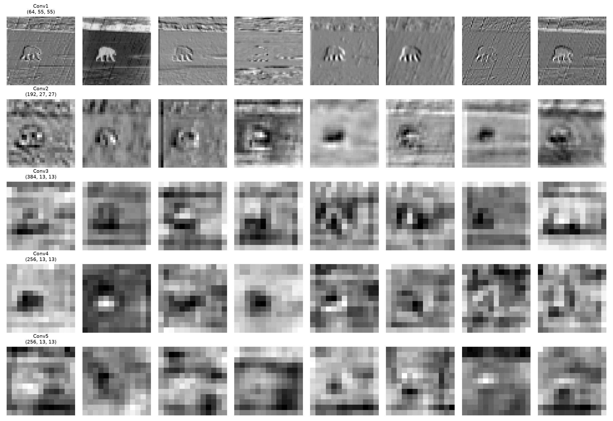

# 基于像素到底有什么不好？😟

## 1. 这里仍然是使用 L1 范数，对输出图像进行逐像素处理，仅仅是多使用了一个预训练模型，为什么 LPIPS 能够更好地衡量感知差异呢🤔

LPIPS 先用预训练网络把图片从"像素点阵"翻译成"特征描述"，再在特征上计算 L1 距离

- 浅层特征记录的是边缘、纹理走向，中层是局部结构，深层是物体部件与内容布局——这正是人眼判断"两张图像不像"时所依据的东西；
- 在这样的特征空间里算 L1，比的是两张图在边缘、纹理、结构这些维度上差多少，而不是每个像素点的数值差多少；
- 多层特征加权求和，相当于同时核对细节层与大局层；特征图经过下采样变小，对小位移和轻微亮度变化有一定的包容度，这也与人眼类似。

总结：LPIPS 是**先把图片翻译成人眼在意的模样，再在这种基础上算 L1**，所以它衡量的差异与人的感知差异类似。

## 2.这里使用的训练好的网络，起到了什么作用？（选做：请你尝试可视化被处理后的图片，观察被预训练模型处理后，图片会出现什么变化）

1. **提供特征空间。** 它曾在海量图片上训练过，内部已经形成了从边缘、纹理到物体部件的通用视觉表示。它把图片从像素空间映射到特征空间，使"特征之间的距离"能够对应"人眼感知的差异"。
2. **提供判断标准。** 它的特征带有从真实图像中学到的视觉规律，而随机权重的网络提取的特征没有语义，算出的距离并不对应人的感知。

### （选做）可视化特征图会看到什么

把中间层的特征图取某个通道画成灰度图，会发现浅层特征图还像原图的线稿或边缘图，能认出轮廓；越往深层，特征图尺寸越小、内容越抽象，变成一块块模糊的亮斑，只标示"哪里有显著的结构或物体"，颜色与细节消失，不同通道分别对不同模式有响应。

### 可视化代码在visualize_features.py

### 输入的原图

### 输出的可视化特征图

## 3. 已在 perceptual_loss 文件中补全代码，使用预训练的 VGG19 模型的前三十五层处理目标和生成的图片，并使用 L1 损失计算得到最终的损失。已调整 main 文件的形参，使用 perceptual_loss 作为损失的一部分，训练并测试模型

### 训练

### 测试

# 你知道什么是向量吗？😊

## 1. 向量是什么，什么是维度

**向量就是一组有序的数字**，比如 (3, 5)、(1, 2, 3)。每个位置的数字含义不同，不能随便交换。

从几何上看，向量也可以画成一个**带方向和长度的箭头**：从原点出发，指向坐标为那组数字的点。

**维度就是这组数字的个数**：

- (3, 5) 有 2 个数，是二维向量，相当于平面上的一个点
- (1, 2, 3) 有 3 个数，是三维向量，相当于空间中的一个点

**总结：**a = (a1, a2, …, an)，其中 n 就是维度。

## 2. 向量内积的两种表示方法，以及为什么和线性代数有关

设两个同维向量 a = (a1, a2, …, an)，b = (b1, b2, …, bn)，它们的内积写作 a·b

### 表示一：代数表示

a·b = a1b1 + a2b2 + … + anbn

即对应位置相乘、再全部加起来。结果是一个数（标量），不再是向量。

### 表示二：几何表示

a·b = |a| · |b| · cos θ

其中 |a|、|b| 是两个向量的长度，θ 是它们之间的夹角。

### 为什么说内积和线性代数关系密切

- **内积给向量空间定义了长度和角度"**：线性代数研究的向量空间本身只定义了加法和数乘，此时向量只有"一组数"，量不了长度、量不了夹角。内积是线性代数从纯代数走向几何的那一步。
- **矩阵乘法本质上就是批量的内积**：矩阵乘向量的每一个结果，都是矩阵的一行与那个向量做内积；矩阵乘矩阵的每个元素，都是一行与一列的内积。
- **Gram 矩阵就是一张"内积表"**：把一组向量两两做内积、排成矩阵，就是 Gram 矩阵。

## 3. 向量内积的意义，以及什么是余弦相似度

### 内积的意义

看内积的符号和大小，就能判断两个向量的关系：

- 内积 **> 0**：方向大致相同（夹角小于 90°），越对齐值越大
- 内积 **= 0**：互相垂直（正交），可以理解为毫不相关
- 内积 **< 0**：方向大致相反（夹角大于 90°）

值得注意的是：内积同时受**方向**和**长度**两个因素影响——向量越大，内积绝对值天然越大。所以内积回答的是"又像、又大"，没把这两件事分开。

### 余弦相似度

cos θ = (a·b) / (|a| · |b|)

这就是余弦相似度，取值永远在 -1 到 1 之间：

- **= 1**：方向完全相同，最相似
- **= 0**：互相垂直，不相关
- **= -1**：方向完全相反，最不相似

它常用来比较"像不像"：比如两张图的特征向量余弦相似度越高，内容越接近。

# 改造感知损失函数，使用特征做对比😏

## 1. 已在 losses 软件包中创建一名为 easy contrastive loss 的文件，已修改 main 文件（包括 get_args、train_one_epoch、main函数），使得能够通过输入形参的方式启用 easy contrastive loss 进行学习

## 2. 已按要求在 easy contrastive loss 文件中编写新的损失函数

## 3. 使用新的损失函数训练并测试模型（不用过多关注指标高低）

### 训练

### 测试

