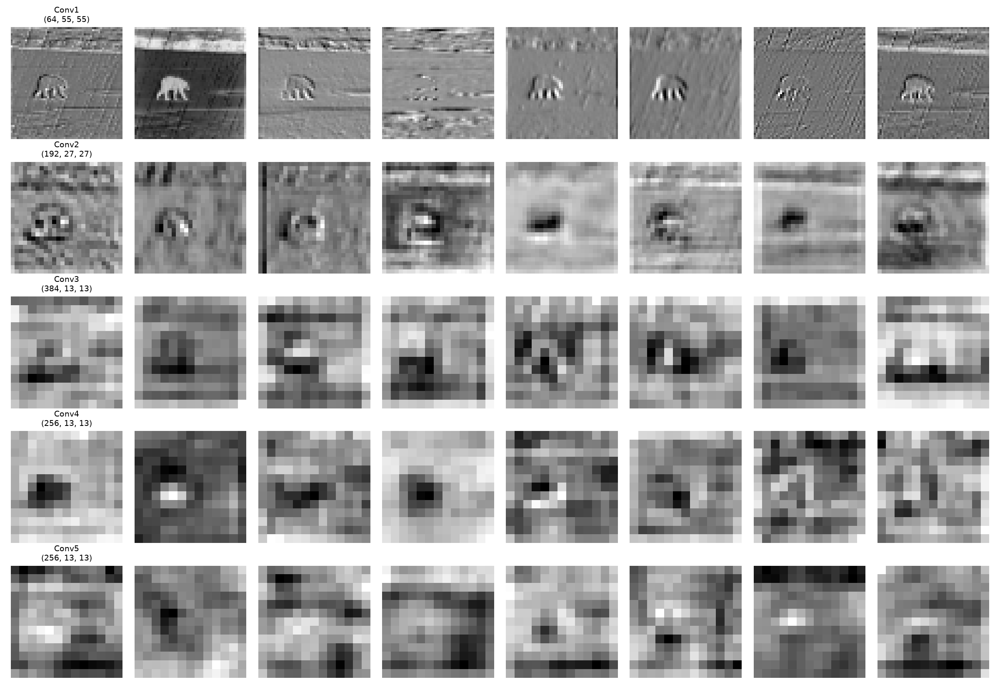

# 基于像素到底有什么不好？😟

## 1. 这里仍然是使用 L1 范数，对输出图像进行逐像素处理，仅仅是多使用了一个预训练模型，为什么 LPIPS 能够更好地衡量感知差异呢🤔

关键在于：**被比较的对象变了，距离公式没变。**

### 普通的像素级 L1 是在像素空间逐点对账，它只有"数值差多少"的概念，没有"看起来差多少"的概念，而且默认每个像素相互独立、同等重要。这与人眼的判断方式并不一致

- 把一张图整体平移 1 个像素，像素 L1 会非常大，但人眼几乎看不出区别；
- 把图中的纹理抹糊、平均化，像素 L1 可能并不大，但人眼可能就会觉得"假、不清晰"。

也就是说，人眼对整体亮度微变、纹理轻微位移等差异不敏感，却对边缘错位、纹理丢失、结构变形这类差异极其敏感。像素 L1 对这两类差异一视同仁地按数值计量，所以与感知对不上。

### LPIPS 先用预训练网络把图片从"像素点阵"翻译成"特征描述"，再在特征上计算 L1 距离

- 浅层特征记录的是边缘、纹理走向，中层是局部结构，深层是物体部件与内容布局——这正是人眼判断"两张图像不像"时所依据的东西；
- 在这样的特征空间里算 L1，比的是两张图在边缘、纹理、结构这些维度上差多少，而不是每个像素点的数值差多少；
- 多层特征加权求和，相当于同时核对细节层与大局层；特征图经过下采样变小，对小位移和轻微亮度变化有一定的包容度，这也与人眼的容忍方式一致。

一句话总结：LPIPS 不是抛弃了 L1，而是**先把图片翻译成人眼在意的语言，再在这种语言上算 L1**，所以它衡量的差异与人的感知差异对齐得更好。

## 2.这里使用的训练好的网络，起到了什么作用？（选做：请你尝试可视化被处理后的图片，观察被预训练模型处理后，图片会出现什么变化）

预训练网络在这里扮演的是**一把训练有素的"尺子"，即特征提取器**：

1. **提供特征空间。** 它曾在海量图片（如 ImageNet 分类任务）上训练过，内部已经形成了从边缘、纹理到物体部件的通用视觉表示。它把图片从像素空间映射到特征空间，使"特征之间的距离"能够对应"人眼感知的差异"。没有这个映射，LPIPS 和感知损失就无从谈起。
2. **提供判断标准。** 之所以必须是"预训练好"的网络，是因为它的特征带有从真实图像中学到的视觉规律；随机权重的网络提取的特征没有语义，算出的距离并不对应人的感知。
3. **本身不参与训练。** 使用时它的权重完全冻结，只做前向传播提取特征，不更新、也不被优化——相当于一位不下场比赛、只负责打分的裁判。这样既省去了自己从头训练一个"视觉系统"的巨大成本，衡量标准也稳定一致。

### （选做）可视化特征图会看到什么

把中间层的特征图取某个通道画成灰度图，会发现它已经不是"照片"了：浅层特征图还像原图的线稿或边缘图，能认出轮廓；越往深层，特征图尺寸越小、内容越抽象，变成一块块模糊的亮斑，只标示"哪里有显著的结构或物体"，颜色与细节消失，不同通道分别对不同模式（如某种方向的边缘、某种纹理）有响应。这说明网络在逐层把图片从"像素"提炼成"内容"，而 LPIPS/感知损失比较的正是这些提炼后的内容。

### 可视化代码在visualize_features.py

### 输入的原图

### 输出的可视化特征图

## 3. 已在 perceptual_loss 文件中补全代码，使用预训练的 VGG19 模型的前三十五层处理目标和生成的图片，并使用 L1 损失计算得到最终的损失。已调整 main 文件的形参，使用 perceptual_loss 作为损失的一部分，训练并测试模型

### 训练

### 测试

# 你知道什么是向量吗？😊

## 1. 向量是什么，什么是维度

**向量就是一组有序的数字**，比如 (3, 5)、(1, 2, 3)。说它"有序"，是说每个位置的数字各有分工、不能随便交换——就像一份档案（身高，体重，年龄），三个数分别管一件事，调换位置意思就全变了。

从几何上看，向量也可以画成一个**带方向和长度的箭头**：从原点出发，指向坐标为那组数字的点。"一组数"和"一个箭头"是同一件事的两种看法，前者方便计算，后者方便想象。

**维度就是这组数字的个数**：

- (3, 5) 有 2 个数，是二维向量，相当于平面上的一个点
- (1, 2, 3) 有 3 个数，是三维向量，相当于空间中的一个点
- 一张 28×28 的灰度图拉平后有 784 个数，就是 784 维向量

可以把维度理解成"描述一个东西需要几个数"：平面上定位一个点，横、竖两个数就够，所以是二维；维度越高，这个向量能装下的信息就越多。在深度学习里，一张图片、一份特征、一个词，本质上都被表示成高维向量来处理。

一般写法：a = (a1, a2, …, an)，其中 n 就是维度，a1 到 an 叫作向量的**分量**。

## 2. 向量内积的两种表示方法，以及为什么和线性代数有关

设两个同维向量 a = (a1, a2, …, an)，b = (b1, b2, …, bn)，它们的内积写作 a·b，有两种等价的表示：

### 表示一：代数表示（按坐标算）

a·b = a1b1 + a2b2 + … + anbn

即对应位置相乘、再全部加起来。结果是一个数（标量），不再是向量。

### 表示二：几何表示（按长度和夹角算）

a·b = |a| · |b| · cos θ

其中 |a|、|b| 是两个向量的长度，θ 是它们之间的夹角。

两个公式算出来的是同一个数：一个从坐标出发，一个从几何出发，内积正是连接这两端的桥。

### 为什么说内积和线性代数关系密切

- **内积给向量空间装上了"尺子和量角器"**。线性代数研究的向量空间本身只定义了加法和数乘，此时向量只有"一组数"，量不了长度、量不了夹角。有了内积，才能反过来定义长度、距离，以及正交（内积为 0 ）。可以说，内积是线性代数从纯代数走向几何的那一步。
- **矩阵乘法本质上就是批量的内积**。矩阵乘向量的每一个结果，都是矩阵的一行与那个向量做内积；矩阵乘矩阵的每个元素，都是一行与一列的内积。神经网络里的全连接层、卷积（在每个小窗口内做内积）、注意力机制中的 Q·K，全都是内积在批量工作。
- **Gram 矩阵就是一张"内积表"**：把一组向量两两做内积、排成矩阵，就是 Gram 矩阵。风格迁移里用 Gram 矩阵记录特征通道之间的相关性，它的元素正是特征向量之间的内积——内积越大，对应两个通道越倾向于同时出现。

## 3. 向量内积的意义，以及什么是余弦相似度

### 内积的意义：量两个向量"有多对齐"

内积可以拆成"a 在 b 方向上落了多少"来看：a 先往 b 的方向上投影，投影的长短表示 a 有多少成分和 b 同方向，再乘上 b 的长度。就像推箱子：力与位移的内积就是真正做的功，斜着推时有一部分力气浪费在垂直方向上，只有顺着位移的那部分才算数，内积算的正是"有效的那部分"。

看内积的符号和大小，就能判断两个向量的关系：

- 内积 **> 0**：方向大致相同（夹角小于 90°），越对齐值越大
- 内积 **= 0**：互相垂直（正交），可以理解为毫不相关
- 内积 **< 0**：方向大致相反（夹角大于 90°）

值得注意的是：内积同时受**方向**和**长度**两个因素影响——向量个头越大，内积绝对值天然越大。所以内积回答的是"又像、又大"，没把这两件事分开。

### 余弦相似度：只比方向、不比个头的内积

把内积除以两个向量的长度，就把"个头"因素消掉了，剩下的恰好是夹角的余弦：

cos θ = (a·b) / (|a| · |b|)

这就是余弦相似度，取值永远在 -1 到 1 之间：

- **= 1**：方向完全相同，最相似
- **= 0**：互相垂直，不相关
- **= -1**：方向完全相反，最不相似

它常用来比较"像不像"而不管"强不强"：比如两段文本的词向量方向越接近，内容越相似；两张图的特征向量余弦相似度越高，内容越接近。

总结：**内积 = 余弦相似度 × |a| × |b|**，余弦相似度就是去掉长度因素之后的内积。

# 改造感知损失函数，使用特征做对比😏

## 1. 已在 losses 软件包中创建一名为 easy contrastive loss 的文件，已修改 main 文件（包括 get_args、train_one_epoch、main函数），使得能够通过输入形参的方式启用 easy contrastive loss 进行学习

## 2. 已按要求在 easy contrastive loss 文件中编写新的损失函数

## 3. 使用新的损失函数训练并测试模型（不用过多关注指标高低）

### 训练

### 测试

